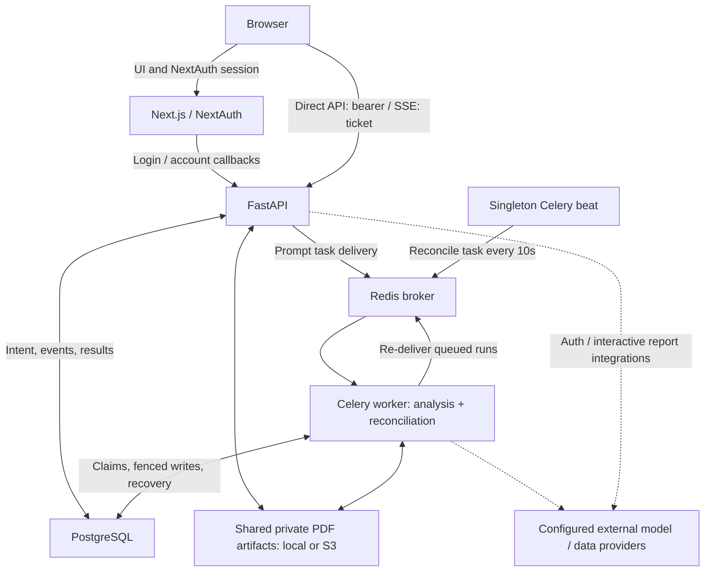
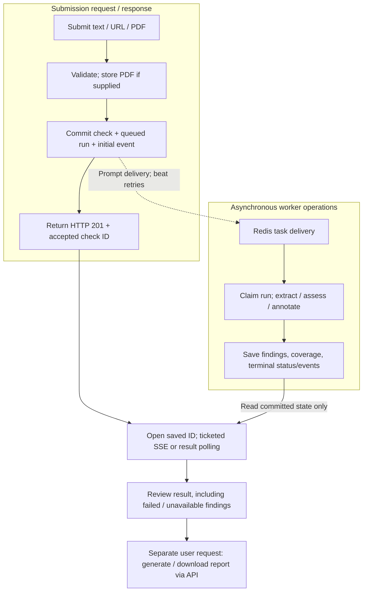
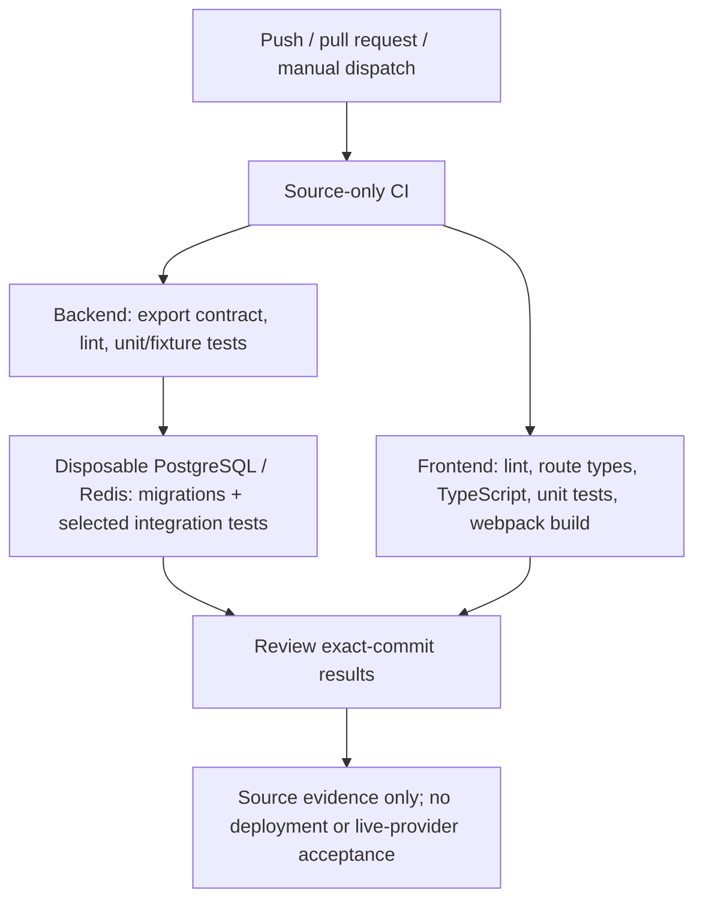
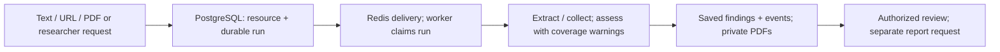

# ArtiProof

Research-integrity tools for a **supervised pilot**, not a verified fact-checking
service or a public self-service launch. ArtiProof helps reviewers inspect source
claims, AI-style estimates, citation metadata and researcher citation patterns.
Findings require human review; model output is not verified evidence, and citation
concentration is not proof of misconduct.

This repository is a sanitized source snapshot for technical review. It is **not
the production service or its deployment repository**. Deployment and operations
remain private; no hosting recipes, infrastructure bindings, customer data or
production credentials are included. Public site/contact defaults use reserved
`example.invalid` placeholders, and showcase notices are not production policies
or a commercial offer. Use **synthetic data only** for local review.

Public history is a re-dated import/snapshot; import dates do not assert when the
original work occurred.

## Current capabilities and limits

- **Source submissions:** pasted text is the default; article URLs, PDF uploads
  and bulk URL/text submissions are also supported. The UI validates inputs,
  retains a returned accepted check ID and opens the saved result when progress
  streaming/ticket acquisition fails. Results poll while work is active. If
  acceptance is uncertain, inspect history before manually submitting again;
  automatic resubmission is not a safe recovery strategy.
- **Source findings:** claim extraction, model-assisted verdicts and optional
  Google Fact Check search results, paragraph-level AI-style estimates with a
  heuristic fallback, and citation/link checks where references are available.
  Coverage warnings expose truncation, sampling, unavailable steps and unsupported
  PDF/pasted-text bibliography extraction. An absence of citation findings is not a
  clean bibliography.
- **Researcher analysis:** ORCID/name lookup, sampled citation relationships,
  self-citation estimates, exploratory concentration observations, history,
  comparisons, bulk lookups and watchlists. Missing/partial evidence can withhold
  assessments. Concentration observations are not validated citation rings.
- **Interactive reports:** source/researcher HTML/PDF views, full/executive,
  comparison and institutional-audit templates, annotations, expiring report share
  links with token rotation, and organization branding where scope permits.
  Comparison/audit inputs must have the same original scope; joining a team does
  not transfer prior personal or other-team work. **Scheduled report creation,
  reactivation and execution are intentionally disabled** pending durable original
  tenant scope. Existing schedule flags do not imply delivery is enabled.
- **Team invitations:** authenticated recipients explicitly review and accept an
  invitation using a matching verified email. Viewing a link or signing up is not
  consent. The UI verifies the refreshed account/organization before showing team
  navigation, preserves refresh-only retry after acceptance, and resets consent
  state on account/token changes. These fixes do not repair historical enrollment
  or resource-provenance problems.

Scores and confidence values are heuristic, not calibrated integrity probabilities
or clearance. AI-style estimates do not establish authorship or accuracy. Fact
Check search can return similar rather than identical claims, and model-generated
sources/verdicts are not guaranteed to have retrieved, matched supporting passages.
Citation accessibility and retraction lookup have provider/unknown-state limits;
absence of a flag is not proof that a reference is valid or unretracted.
Historical results are not automatically recomputed or certified by new code.

Authenticated end-to-end QA, reference-grounding quality, live-provider and deployed
storage/recovery acceptance, operational ownership and partner validation are not
established by this source snapshot. Routine review leaves optional providers
unconfigured and uses no real API keys; network-capable integrations remain in
the source. Unit/fixture tests do not establish production or billing readiness.

## How the project works

### 1. Application architecture (current code, not a deployed topology)

Next.js serves the UI and NextAuth endpoints. Its auth callbacks contact FastAPI;
the browser also calls FastAPI directly with the session bearer token, or a scoped
ticket for SSE. PostgreSQL holds durable intent, progress and findings; Redis
delivers tasks. Singleton beat schedules reconciliation **on the worker**, which
repairs expired runs and retries delivery. SSE only observes saved progress.



Sources: [NextAuth callbacks](frontend/src/lib/auth.ts),
[direct API client](frontend/src/lib/api.ts),
[submission routes](backend/app/routers/source_check.py),
[worker claims/reconciliation](backend/app/services/analysis_runs.py),
[beat dispatch](backend/app/tasks/analysis_tasks.py), and
[private storage contract](backend/app/services/artifact_storage.py). Dotted provider
arrows mean configuration-dependent integrations, not verified provider availability.

### 2. Source check: submission to saved result/report

This flow covers single text/URL/PDF source checks, not every researcher operation.
Submission commits the check/run/event before returning HTTP 201 with its accepted
ID; it does not wait for analysis. Broker delivery may fail or repeat. Workers
claim/fence writes, but external requests/costs are **not guaranteed exactly-once**.



If ticket/stream acquisition fails after acceptance, open the saved ID; active
results poll. If acceptance itself is uncertain, inspect history before manually
resubmitting—**no automatic unsafe submission replay**. SSE neither executes nor
cancels work. Interactive report generation is a separate API operation over saved,
authorized data, not an automatic worker stage. Researcher runs use a different
collection/analysis pipeline and preserve prior revisions on retries.

Sources: [transactional source creation](backend/app/services/source_verification/orchestrator.py),
[submission/accepted-ID recovery](frontend/src/app/%28dashboard%29/check/page.tsx),
[SSE observation](backend/app/routers/source_check.py),
[durable execution](backend/app/services/analysis_runs.py),
[result polling](frontend/src/hooks/use-analysis-refresh.ts),
[researcher pipeline](backend/app/tasks/researcher_tasks.py), and
[interactive reports](backend/app/routers/reports.py).

### 3. Engineering review

Review source changes on branches and pull requests against an exact commit and
its check results. Issues track follow-up work; a passing check is not acceptance
of a deployed service. Deployment authorization and private delivery procedures
are outside this repository.

### 4. Current source-only CI

The included [showcase workflow](.github/workflows/showcase-ci.yml) runs on pushes,
pull requests and manual dispatch. Backend checks cover the export contract,
error-focused lint, unit/fixture tests, migrations and selected PostgreSQL/Redis
integration tests with a zero-skip guard. Frontend checks cover lint, generated
route types, TypeScript, unit tests and a webpack production build.



Workflow permissions are read-only (`contents: read`); provider keys are empty and
services use synthetic credentials. No image publication, CD, hosting webhook,
browser acceptance, separate security-scanner workflow or production integration
is included. Green source checks are not a clean dependency audit or a
pilot-readiness certificate.

## For data engineers

Start with the [relational models](backend/app/models/),
[migrations](backend/alembic/versions/),
[durable runs/events](backend/app/services/analysis_runs.py),
[coverage contracts](backend/app/services/source_verification/coverage.py),
[original-scope reports](backend/app/routers/reports.py) and
[private artifact interface](backend/app/services/artifact_storage.py).



This diagram describes **implemented code**, not deployed infrastructure. PostgreSQL
stores intent; Redis only delivers tasks. Provider calls/costs may repeat. Local
development uses disposable PostgreSQL; migrations describe schema evolution,
not authorization to modify any existing service.

| Status | Data-engineering scope |
| --- | --- |
| Implemented in source | Relational models/migrations, fenced runs/events, partial-result coverage, original-scope interactive reports, private artifact interface; scheduled reports disabled |
| Review boundaries | Synthetic data only; API and workers share the same database, broker and private artifact configuration |
| Not established by source checks | Retained-data compatibility, paired DB/PDF restore, provider quality/cost, capacity/SLOs and deployed HTTPS journeys |

## Local development quick start

This is a **fresh, disposable development database** path, not a retained-data
upgrade or deployment recipe. Use Python 3.12, Node 22, PostgreSQL 16 and Redis 7
(the CI runtime lines). SQLite is not supported for the PostgreSQL-specific
migrations. Commands below use a Bash/Linux-style shell; use a suitable Linux/WSL
environment for Celery. Native PDF rendering requires WeasyPrint's platform
libraries; this edit does not establish native PDF or browser acceptance.

### 1. Configure locally

Set process environment variables from the synthetic root
[`.env.example`](.env.example) template in **each** application terminal. The
backend does **not** automatically read dotenv files. Never overwrite existing
configuration or commit local secrets. Replace both local auth placeholders with
different random values, for example generated with
`python -c "import secrets; print(secrets.token_hex(32))"`.

- Backend configuration is defined in [Settings](backend/app/config.py): set a
  strong `JWT_SECRET`, `DATABASE_URL` (`postgresql+asyncpg://`),
  `DATABASE_URL_SYNC` (`postgresql://`) and `REDIS_URL` for your dedicated local
  services. The template matches the loopback ports 55439/56389 below. Its
  database password is synthetic and only for these disposable local services.
  For other local credentials, use strong randomly generated URL-safe passwords
  (at least 32 characters from letters, digits, `-` and `_`) and URI-safe
  database/user identifiers (letters, digits and `_`, starting with a letter).
  The current [Alembic configuration](backend/alembic/env.py) passes
  `DATABASE_URL_SYNC` through ConfigParser interpolation unchanged:
  percent-encoded sync URLs can be rejected before connection. Ordinary URL
  encoding alone does not make this migration path work; do not blanket
  double-encode URLs across database consumers.
- Set `APP_URL`/CORS for the local frontend. API and workers must use the same
  database, broker and private artifact configuration. For host processes, use
  the same absolute `ARTIFACT_LOCAL_ROOT`; see
  [artifact storage](backend/app/services/artifact_storage.py).
- Frontend: set `NEXTAUTH_URL=http://localhost:3000`, a strong `NEXTAUTH_SECRET`,
  `NEXT_PUBLIC_BACKEND_URL=http://localhost:8000` and
  `NEXT_PUBLIC_SITE_URL=http://localhost:3000`. The backend URL is consumed by
  both the [API client](frontend/src/lib/api.ts) and
  [server-side authentication](frontend/src/lib/auth.ts).
- Leave provider keys empty for routine review. `LLM_PROVIDER` selects the
  provider, but some source stages still check `GEMINI_API_KEY`; do not assume
  alternate-provider parity. `GOOGLE_FACTCHECK_API_KEY` gates review search.
  Google sign-in requires frontend `GOOGLE_CLIENT_ID` / `GOOGLE_CLIENT_SECRET`
  and matching backend `GOOGLE_CLIENT_ID`. Email delivery uses `RESEND_API_KEY`
  and an approved `EMAIL_FROM`; otherwise development uses a logs-only stub.
  These are optional configuration boundaries, not instructions to enable live
  services. Missing integrations can yield partial/unavailable results, not
  successful verification. Do not use production keys/data for development.

### 2. Start only the data services

If Docker is already installed, run each disposable **local test service** in its
own terminal. No Compose file or application image recipe is included.

```bash
docker run --name artiproof-showcase-pg -p 127.0.0.1:55439:5432 -e POSTGRES_USER=showcase -e POSTGRES_PASSWORD=showcase -e POSTGRES_DB=showcase postgres:16-alpine
docker run --name artiproof-showcase-redis -p 127.0.0.1:56389:6379 redis:7-alpine
```

### 3. Install backend dependencies and migrate before starting writers

For an existing database, do not run this fresh-database sequence. Use only the
dedicated disposable services configured above.

```bash
cd backend
python -m venv .venv
source .venv/bin/activate
python -m pip install -r requirements.txt -r requirements-dev.txt
alembic upgrade head
uvicorn app.main:app --host 127.0.0.1 --port 8000
```

Apply migrations once, before API/worker/beat startup, not concurrently in every
process. Alembic manages the schema. Create only synthetic local review accounts
through the application.

### 4. Start worker and singleton beat

In separate terminals, from `backend` with the same activated virtualenv and local
process environment:

```bash
celery -A app.tasks.celery_app worker --pool=solo --loglevel=info
```

```bash
celery -A app.tasks.celery_app beat --loglevel=info
```

Run exactly one beat process. PostgreSQL saves submission intent; Redis delivers
work; beat reconciles queued runs and expired attempts every ten seconds. Without
a worker, work stays queued; without beat, durable delivery retries/recovery stop.
SSE observes saved progress and never executes analysis. Provider calls/costs may
repeat after crashes. See [durable execution](backend/app/services/analysis_runs.py).

Default beat also registers daily cleanup at 03:00 UTC, including hard deletion
after the soft-delete retention window and orphan artifact cleanup. It does
**not** enable scheduled reports. Never start these commands against retained,
shared or production services/data.

### 5. Start the frontend

In another terminal, from the repository root, with the frontend environment above:

```bash
cd frontend
npm ci --ignore-scripts
npm run dev -- --hostname 127.0.0.1
```

Local development only: open <http://localhost:3000>; API docs are at
<http://localhost:8000/docs>. These loopback URLs are not deployed website links.

## Retained-data upgrades and operations

Preserve existing data. Before any authorized upgrade, stop submissions and old
writers, inventory migration/schema state, take paired database/artifact backups,
verify an isolated restore, and obtain migration-owner approval. Serialize the
reviewed migration before compatible processes restart. A generic baseline stamp
or database downgrade is **not** a safe production recipe. Old-image rollback
alone does not establish data/schema compatibility.

Operational runbooks, artifact-maintenance CLI/tests, internal reports and
authenticated operational QA tooling are not part of this export. Application
artifact storage, authorization, audit logs and schema migrations remain included;
their presence is not a retained-data remediation or recovery certificate.

## Verification

Commands below describe test selection, not checks executed for this README edit.
Use dedicated test databases, Redis queues and artifact roots, never customer data.
Backend dependencies come from both requirements files:

```bash
cd backend
python -m pip install -r requirements.txt -r requirements-dev.txt
python -m pytest -q
```

Default pytest excludes `integration`. Real-service tests need an explicitly
configured, migrated dedicated `ARTIPROOF_INTEGRATION_DATABASE_URL`; the Redis
delivery case also needs `ARTIPROOF_INTEGRATION_REDIS_URL`. Follow the exact
required file selection and zero-skip guard in
[CI](.github/workflows/showcase-ci.yml), rather than treating skipped tests or
SQLite/stubs as PostgreSQL evidence. Live object-store tests require separately
configured infrastructure and are not routine CI evidence.

Frontend checks, from `frontend` after `npm ci --ignore-scripts`:

```bash
npm run lint
npx next typegen
npx tsc --noEmit
npm run test:unit
npm run build -- --webpack
```

The exported tree has no Playwright smoke configuration or browser suite; the
remaining package script is not evidence of a runnable acceptance harness.
Ordinary jsdom/component tests are not authenticated journey, native PDF or
live-provider acceptance. Use exact-SHA GitHub check records, not a fixed README
test count. Green CI is not a clean dependency audit or pilot-readiness certificate.

## Security boundaries

- Private resource routes use bearer authentication and ownership/org policies;
  not every `/api/*` route is private. Auth flows, health, share-token capabilities
  and other explicit public/signed endpoints have different controls.
- Report share URLs grant access without sign-in until expiry/rotation/deletion
  checks deny it. Treat them as sensitive capabilities, not private team links.
- Password hashing uses bcrypt via passlib; route-specific rate limits use slowapi.
  Demo seeding requires explicit opt-in and is blocked in production.
- PDF source upload checks include filename, size and `%PDF-` signature; these
  checks are not a guarantee that arbitrary document content is safe.
- Frontend CSP defaults to Report-Only; enforcement requires `CSP_ENFORCE=true`
  at build time for a normal Node deployment (static export skips headers).
  Do not describe a reporting-only policy as enforced protection.
- New consent/scope guards do not remediate historical memberships, cached reports
  or shares. No universal isolation, deletion/compliance or security clearance is
  claimed. See [invitation consent](frontend/src/components/invitation-consent.tsx),
  [membership guards](backend/app/services/team_invites.py) and
  [report scope/schedule restrictions](backend/app/routers/reports.py).

## Stack and repository

| Layer | Implementation |
| --- | --- |
| Frontend | Next.js 16, React 19, Tailwind CSS 4, Framer Motion, NextAuth |
| Backend | FastAPI, SQLAlchemy 2 async, PostgreSQL, Alembic |
| Background work | Celery, Redis, singleton beat, PostgreSQL durable runs/events |
| Analysis/data | Configurable LLM clients; Google Fact Check, CrossRef, ORCID, Semantic Scholar and optional Scopus integrations |
| Reports/storage | Python HTML templates, WeasyPrint with PyMuPDF fallback, shared private local or S3-compatible artifacts |

```text
backend/app/routers/       # API routes and authorization boundaries
backend/app/services/     # source/researcher pipelines, durable runs, reports, storage
backend/app/tasks/         # workers, reconciliation, cleanup; disabled report sweep
backend/app/models/       # SQLAlchemy models
backend/app/schemas/      # Pydantic API contracts
backend/alembic/          # reviewed database migrations
backend/tests/            # unit and opt-in real-service integration suites
frontend/src/app/         # Next.js landing, auth, dashboard and shared views
frontend/src/components/  # UI and feature components
frontend/src/lib/         # API/auth, errors, explanations and shared helpers
frontend/src/types/       # frontend API shapes
showcase_tests/           # source export boundary checks
.github/workflows/        # source-only CI
```

## License

Proprietary. © ArtiProof.

Existing source copyright/attribution headers are retained. Bundled fonts retain
their original copyright and SIL Open Font License notices under
[`frontend/src/app/fonts/`](frontend/src/app/fonts/), including upstream asset
provenance. These licenses apply to the fonts, not to the application.
No application-wide license grant was supplied with this snapshot; public
availability is not a new license grant. Dependencies remain subject to their
respective licenses. This snapshot does not claim the work of existing
contributors as newly authored.
