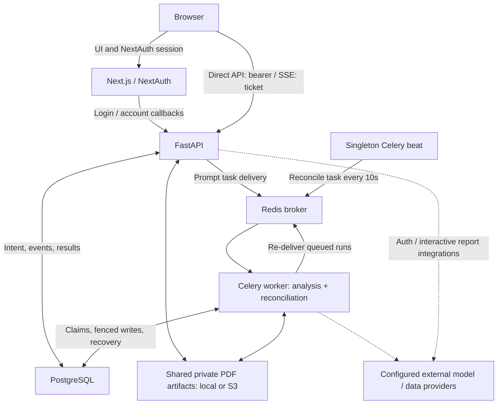
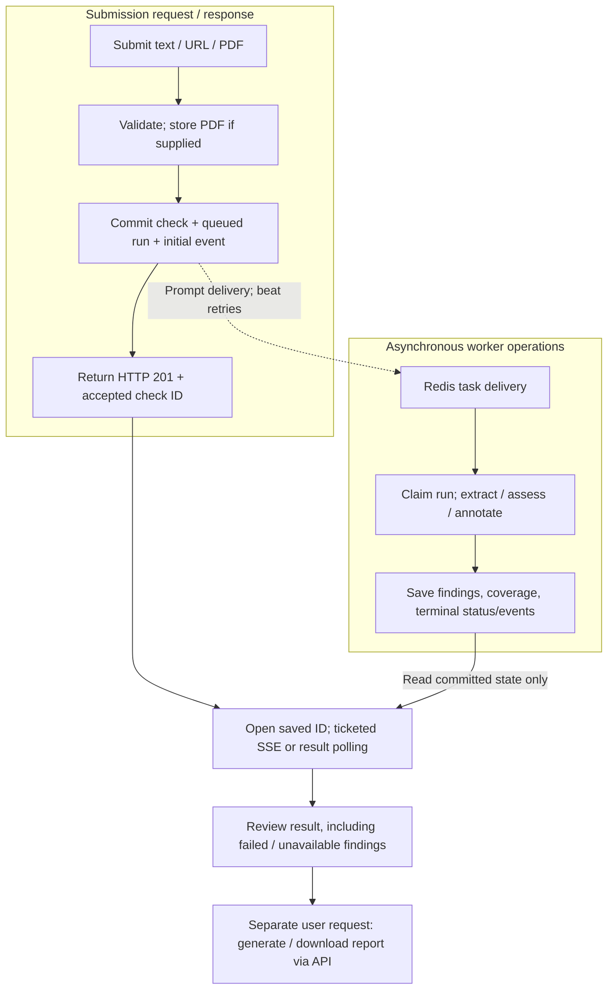
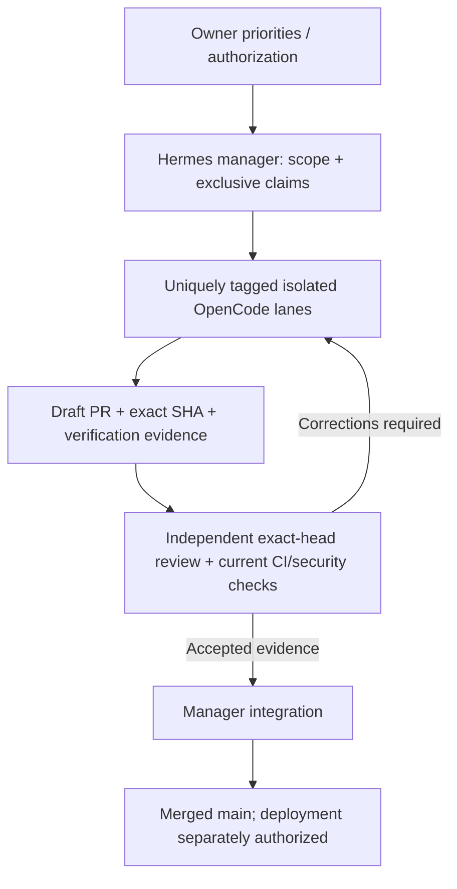
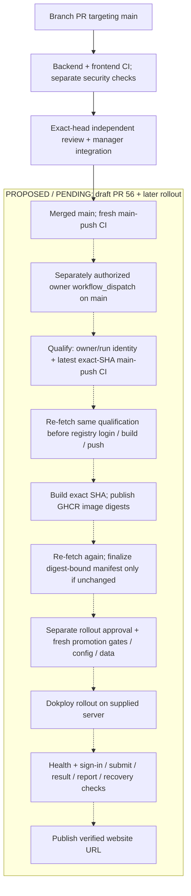
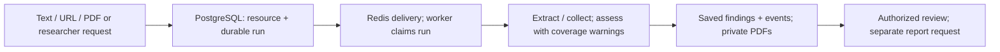

# ArtiProof

Research-integrity tools for a **supervised pilot**, not a verified fact-checking
service or a public self-service launch. ArtiProof helps reviewers inspect source
claims, AI-style estimates, citation metadata and researcher citation patterns.
Findings require human review; model output is not verified evidence, and citation
concentration is not proof of misconduct.

**Staging website: not deployed / URL pending verified deployment.**
An isolated Dokploy project/environment has been prepared, but no application
deployment or public website URL is verified. Staging build/CI preparation is in
[draft PR #56](https://github.com/JafarShamzsi/ArtiProof/pull/56), not merged
deployment tooling on main. The owner intends deployment to the supplied Dokploy
server (IP-based access initially, domain later), using an owner-supplied/identified,
approved sanitized copy of existing data and associated artifacts, not an empty
replacement database. Exact-SHA build authorization, runtime/data prerequisites and
verified app/API origins remain pending; the candidate currently requires HTTPS
origins, so IP-first routing/TLS still needs resolution. No public port or website
URL is established; the Dokploy admin panel is not the website. Dokploy, not Railway,
is the intended target. Merging code does not authorize deployment or waive holds.

## Current capabilities and limits

- **Source submissions:** pasted text is the default; article URLs, PDF uploads
  and bulk URL/text submissions are also supported. The UI validates inputs,
  retains a returned accepted check ID and opens the saved result when progress
  streaming/ticket acquisition fails. Results poll while work is active. If
  acceptance is uncertain, inspect history before manually submitting again;
  automatic resubmission is not a safe recovery strategy.
- **Source findings:** claim extraction, model-assisted verdicts and optional
  Google Fact Check search results, paragraph-level AI-style estimates with a
  heuristic fallback, and citation/link checks where references are available.
  Coverage warnings expose truncation, sampling, unavailable steps and unsupported
  PDF/pasted-text bibliography extraction. An absence of citation findings is not a
  clean bibliography.
- **Researcher analysis:** ORCID/name lookup, sampled citation relationships,
  self-citation estimates, exploratory concentration observations, history,
  comparisons, bulk lookups and watchlists. Missing/partial evidence can withhold
  assessments. Concentration observations are not validated citation rings.
- **Interactive reports:** source/researcher HTML/PDF views, full/executive,
  comparison and institutional-audit templates, annotations, expiring report share
  links with token rotation, and organization branding where scope permits.
  Comparison/audit inputs must have the same original scope; joining a team does
  not transfer prior personal or other-team work. **Scheduled report creation,
  reactivation and execution are intentionally disabled** pending durable original
  tenant scope. Existing schedule flags do not imply delivery is enabled.
- **Team invitations:** authenticated recipients explicitly review and accept an
  invitation using a matching verified email. Viewing a link or signing up is not
  consent. The UI verifies the refreshed account/organization before showing team
  navigation, preserves refresh-only retry after acceptance, and resets consent
  state on account/token changes. These fixes do not repair historical enrollment
  or resource-provenance problems.

Scores and confidence values are heuristic, not calibrated integrity probabilities
or clearance. AI-style estimates do not establish authorship or accuracy. Fact
Check search can return similar rather than identical claims, and model-generated
sources/verdicts are not guaranteed to have retrieved, matched supporting passages.
Citation accessibility and retraction lookup have provider/unknown-state limits;
absence of a flag is not proof that a reference is valid or unretracted.
Historical results are not automatically recomputed or certified by new code.

Pilot gates remain open: authenticated end-to-end QA, reference-grounding quality,
retained-data provenance/remediation, live-provider and deployed storage/recovery
acceptance, operational ownership and partner validation. See the
[delivery board](docs/PILOT-DELIVERY.md),
[authenticated QA evidence/holds](docs/AUTHENTICATED-QA.md) and
[release/recovery runbook](docs/PILOT-RELEASE-RUNBOOK.md).
Historical milestone/runbook logs are evidence at their stated revisions, not
current release certificates; GitHub issue/PR records carry current status.

## How the project works

### 1. Application architecture (current code, not a deployed topology)

Next.js serves the UI and NextAuth endpoints. Its auth callbacks contact FastAPI;
the browser also calls FastAPI directly with the session bearer token, or a scoped
ticket for SSE. PostgreSQL holds durable intent, progress and findings; Redis
delivers tasks. Singleton beat schedules reconciliation **on the worker**, which
repairs expired runs and retries delivery. SSE only observes saved progress.



Sources: [NextAuth callbacks](frontend/src/lib/auth.ts#L75-L222),
[direct API client](frontend/src/lib/api.ts#L26-L57),
[submission routes](backend/app/routers/source_check.py#L101-L180),
[worker claims/reconciliation](backend/app/services/analysis_runs.py),
[beat dispatch](backend/app/tasks/analysis_tasks.py), and
[private storage contract](docs/artifact-storage.md). Dotted provider arrows mean
configuration-dependent integrations, not verified provider availability.

### 2. Source check: submission to saved result/report

This flow covers single text/URL/PDF source checks, not every researcher operation.
Submission commits the check/run/event before returning HTTP 201 with its accepted
ID; it does not wait for analysis. Broker delivery may fail or repeat. Workers
claim/fence writes, but external requests/costs are **not guaranteed exactly-once**.



If ticket/stream acquisition fails after acceptance, open the saved ID; active
results poll. If acceptance itself is uncertain, inspect history before manually
resubmitting—**no automatic unsafe submission replay**. SSE neither executes nor
cancels work. Interactive report generation is a separate API operation over saved,
authorized data, not an automatic worker stage. Researcher runs use a different
collection/analysis pipeline and preserve prior revisions on retries.

Sources: [transactional source creation](backend/app/services/source_verification/orchestrator.py#L81-L109),
[submission/accepted-ID recovery](frontend/src/app/%28dashboard%29/check/page.tsx#L122-L268),
[SSE observation](backend/app/routers/source_check.py#L332-L393),
[durable execution and polling](docs/analysis-execution.md),
[researcher execution branch](backend/app/services/analysis_runs.py#L115-L179), and
[interactive reports](backend/app/routers/reports.py#L259-L482).

### 3. Engineering orchestration (supervised delivery process)

The owner sets priorities; Hermes manages scope, ownership and integration.
OpenCode implementation lanes use unique tags, isolated branches/worktrees and
one writer per owned path. Shared files/contracts are serialized, not edited
competitively. Corrections return to the assigned lane for a new exact-head review.



This is a process-level review requirement, **not enforced two-person identity**:
unique agent tags are not authenticated principals, and a shared GitHub login
cannot provide independent-account approval. Sources: [delivery contract](AGENTS.md),
[Hermes/OpenCode tooling and serialized ownership](docs/PILOT-DELIVERY.md#tool-policy-and-portability),
and [manager-authorized README lane](https://github.com/JafarShamzsi/ArtiProof/pull/57#issuecomment-6719636781).

### 4. CI now; proposed candidate and Dokploy rollout

Current PR-to-main CI runs backend lint/migrations/unit/real-service integration
and frontend types/lint/unit/webpack build/smoke. Main pushes run CI again;
manual and merge-group triggers also exist. Security has a separate Bandit job;
CodeQL analysis is conditional on confirmed licensing. Manager review must check
all required security results, including GitGuardian—not infer them from green CI.



**Legend:** solid arrows are the current engineering/CI path; dotted arrows inside
the pending subgraph are unexecuted candidate/rollout steps, not live automation.
[Draft PR #56](https://github.com/JafarShamzsi/ArtiProof/pull/56) contains the proposed
`staging.yml` and `docs/DOKPLOY-STAGING.md`; neither exists on main yet. Its workflow
only builds candidates, never calls Dokploy. It requires a fresh first-attempt
owner dispatch with matching SHA confirmation (reruns denied), configured HTTPS
API origin, and repeated unchanged CI/authorization qualification. Images can
already exist if final refresh fails; that does not produce an approved candidate.
Digest manifests bind source/CI/run/config, not human intent or an atomic future-CI
lock. Security disposition and explicit build/deploy approval remain separate.

No automatic GitHub-to-Dokploy webhook is established. Later promotion must
revalidate fresh exact-SHA evidence and approved sanitized existing DB/artifacts,
routing/TLS and runtime prerequisites; there is **no application deployment yet**.
Only verified health/journey evidence can establish the eventual website URL.
Sources: [CI workflow](.github/workflows/ci.yml),
[Bandit workflow](.github/workflows/security.yml),
[conditional CodeQL](.github/workflows/codeql.yml),
[check limitations](docs/CI-RUNBOOK.md), and
[candidate workflow/runbook under review](https://github.com/JafarShamzsi/ArtiProof/pull/56).

## For data engineers

Start with the [data-engineering handbook](docs/DATA-ENGINEERING.md): source-traced
relationships, ingestion/lineage, execution limits, original tenant scope, private
artifacts, and a production review/acceptance checklist.



This diagram describes **implemented code**, not deployed infrastructure. PostgreSQL
stores intent; Redis only delivers tasks. Provider calls/costs may repeat. Local
development uses local PostgreSQL. Neon is the temporary retained-data source;
intended production is portable self-hosted PostgreSQL on the Dokploy server or a
dedicated server. Cutover/restore/reconciliation, TLS and IP-first/HTTPS adaptation
still need separate review and authorization.

| Status | Data-engineering scope |
| --- | --- |
| Implemented in source | Relational models/migrations, fenced runs/events, partial-result coverage, original-scope interactive reports, private artifact interface; scheduled reports disabled |
| In progress / planned | DB-01 connection/TLS foundations; DATA-03 offline metadata contract/planner; reviewed sanitized-copy/import and recovery process—not implemented guarantees on this branch |
| Live unverified | PostgreSQL 17 versus CI PostgreSQL 16, retained-data compatibility, paired DB/PDF restore, provider quality/cost, capacity/SLOs and deployed HTTPS journey; staging not deployed |

Engineers can review the handbook before production validation. It is not a
deployment certificate; no migration, import or live access is authorized by it.

## Local development quick start

This is a **fresh, disposable development database** path, not a retained-data
upgrade or staging deployment recipe. Use Python 3.12 and Node 22 (the CI runtime
lines), PostgreSQL and Redis. The commands below use a Bash/Linux-style shell;
use a suitable Linux/WSL environment for Celery and install the PDF system
libraries listed in [the backend image recipe](backend/Dockerfile) for host PDF
rendering. These are setup instructions, not a claim of tested container startup.

### 1. Configure locally

If absent, copy the root `.env.example` to `.env`; never overwrite existing
configuration. Create `frontend/.env.local` yourself (there is no frontend env
example in this tree). Do not commit either file or share their contents.

- Root backend configuration is defined in
  [Settings](backend/app/config.py): set a strong `JWT_SECRET`,
  `DATABASE_URL` (`postgresql+asyncpg://`), `DATABASE_URL_SYNC` (`postgresql://`)
  and `REDIS_URL` for your dedicated local services. With Compose data services
  below, host connections use loopback ports 5432/6379, matching `DB_USER`,
  `DB_PASSWORD`, `DB_NAME` and the Redis `REDIS_PASSWORD`. Redis requires a
  password; include it in the URL. For this fresh disposable local path, use
  strong randomly generated URL-safe passwords (at least 32 characters from
  letters, digits, `-` and `_`) and URI-safe database/user identifiers
  (letters, digits and `_`, starting with a letter), so no percent encoding
  is needed. The current [Alembic configuration](backend/alembic/env.py#L20-L21)
  passes `DATABASE_URL_SYNC` through ConfigParser interpolation unchanged:
  percent-encoded sync URLs can be rejected before connection. Ordinary URL
  encoding alone does not make this migration path work; do not blanket
  double-encode URLs across database consumers.
- Set `APP_URL`/CORS for the local frontend. API and workers must use the same
  database, broker and private artifact configuration. For host processes, use
  the same absolute `ARTIFACT_LOCAL_ROOT`; see
  [artifact storage](docs/artifact-storage.md).
- Frontend: set `NEXTAUTH_URL=http://localhost:3000`, a strong `NEXTAUTH_SECRET`
  and `NEXT_PUBLIC_BACKEND_URL=http://localhost:8000`. The latter is consumed by
  both the [API client](frontend/src/lib/api.ts) and
  [server-side authentication](frontend/src/lib/auth.ts).
- Provider features need explicitly configured keys. `LLM_PROVIDER` selects the
  provider, but some source stages still check `GEMINI_API_KEY`; do not assume
  alternate-provider parity. `GOOGLE_FACTCHECK_API_KEY` enables review search.
  Google sign-in additionally needs frontend `GOOGLE_CLIENT_ID` /
  `GOOGLE_CLIENT_SECRET` and matching backend `GOOGLE_CLIENT_ID`. Email delivery
  needs `RESEND_API_KEY` and an approved `EMAIL_FROM`; otherwise development uses
  a logs-only stub. Missing integrations can yield partial/unavailable results,
  not successful verification. Do not use production keys/data for development.

### 2. Start only the data services

From the repository root, after configuration:

```bash
docker compose up -d postgres redis
```

Do **not** also start Compose `backend`/`worker` with the host-process path below.
The full Compose file starts those services too, does not start the frontend,
and its backend image command does not apply migrations. Its shared volumes and
default daily cleanup are development configuration, not a safe retained-data
deployment plan.

### 3. Install backend dependencies and migrate before starting writers

For an existing database, do not run this fresh-database sequence; follow the
upgrade section instead. This sequence requires the URL-safe local credentials
and identifiers above because of the current sync-URL/Alembic interpolation
limitation; migrations have not been runtime-verified for this README edit.

```bash
cd backend
python -m venv .venv
source .venv/bin/activate
python -m pip install -r requirements.txt
alembic upgrade head
uvicorn app.main:app --reload --port 8000
```

Apply migrations once, before API/worker/beat startup, not concurrently in every
process. Alembic manages the schema; the historical Prisma schema is not applied.

### 4. Start worker and singleton beat

In another terminal, from `backend` with the same virtualenv and configuration:

```bash
celery -A app.tasks.celery_app worker --beat --loglevel=info
```

This combined command is for **one development worker only**. With multiple
workers, omit `--beat` on workers and run exactly one separate
`celery -A app.tasks.celery_app beat --loglevel=info` process.
PostgreSQL saves submission intent; Redis delivers work; beat reconciles queued
runs and expired attempts every ten seconds. Without a worker, work stays queued;
without beat, durable delivery retries/recovery stop. SSE observes saved progress
and never executes analysis. Provider calls/costs may repeat after crashes.
See [durable execution](docs/analysis-execution.md).

Default beat also registers daily cleanup at 03:00 UTC, including hard deletion
after the soft-delete retention window and orphan artifact cleanup. It does
**not** enable scheduled reports. Do not run this default cleanup against retained
data during a rollback window; the release runbook requires separate DB-deletion
and artifact-cleanup holds.

### 5. Start the frontend

In another terminal, from the repository root:

```bash
cd frontend
npm ci
npm run dev
```

Local development only: open <http://localhost:3000>; API docs are at
<http://localhost:8000/docs>. These loopback URLs are not deployed website links.

## Retained-data upgrades and operations

Preserve existing data. Before any authorized upgrade, stop submissions and old
writers, inventory migration/schema state, take paired database/artifact backups,
verify an isolated restore, and obtain migration-owner approval. Serialize the
reviewed `alembic upgrade head` before compatible processes restart. A generic
baseline stamp or database downgrade is **not** a safe production recipe.
Old-image rollback alone does not establish data/schema compatibility.

- [Release/recovery runbook](docs/PILOT-RELEASE-RUNBOOK.md): migration ordering,
  paired recovery points, rollback, deletion holds and manual go/no-go.
- [Analysis execution](docs/analysis-execution.md): drain/upgrade, legacy jobs,
  ownership, replay and worker/beat requirements.
- [Artifact storage/migration](docs/artifact-storage.md): shared private local/S3
  storage, plan/apply/resume, source preservation and live-provider limits.
- [Legacy-data plan](docs/LEGACY-DATA-PLAN.md): offline inventory/remediation
  design; tests do not certify existing records. Retained-data remediation is
  required by the owner; a clean database is not a substitute.

## Verification

Commands below describe test selection, not checks executed for this README edit.
Use dedicated test databases, Redis queues and artifact roots, never customer data.
Backend dependencies come from both requirements files:

```bash
cd backend
python -m pip install -r requirements.txt -r requirements-dev.txt
python -m pytest -q
```

Default pytest excludes `integration`. Real-service tests need an explicitly
configured, migrated dedicated `ARTIPROOF_INTEGRATION_DATABASE_URL`; the Redis
delivery case also needs `ARTIPROOF_INTEGRATION_REDIS_URL`. Follow the exact
required file selection and zero-skip guard in
[CI](.github/workflows/ci.yml) and the [CI runbook](docs/CI-RUNBOOK.md), rather
than treating skipped tests or SQLite/stubs as PostgreSQL evidence.

Frontend checks, from `frontend` after `npm ci`:

```bash
npm run test:unit
npx tsc --noEmit
npm run lint
npm run build -- --webpack
npm run test:smoke
```

Playwright needs its reviewed browser/system prerequisites. CI smoke consumes the
production build; local defaults can start a development server. Ordinary smoke
and jsdom/component tests are not authenticated journey or live-provider acceptance;
the [authenticated QA harness](docs/AUTHENTICATED-QA.md) remains separately held.
Use exact-SHA GitHub check records, not a fixed README test count. Green CI is not
a clean dependency audit or pilot-readiness certificate; scanner limitations and
advisory gates are documented in the CI runbook and
[dependency security notes](docs/DEPENDENCY-SECURITY.md).

## Security boundaries

- Private resource routes use bearer authentication and ownership/org policies;
  not every `/api/*` route is private. Auth flows, health, share-token capabilities
  and other explicit public/signed endpoints have different controls.
- Report share URLs grant access without sign-in until expiry/rotation/deletion
  checks deny it. Treat them as sensitive capabilities, not private team links.
- Password hashing uses bcrypt via passlib; route-specific rate limits use slowapi.
  Demo seeding requires explicit opt-in and is blocked in production.
- PDF source upload checks include filename, size and `%PDF-` signature; these
  checks are not a guarantee that arbitrary document content is safe.
- Frontend CSP defaults to Report-Only; enforcement requires `CSP_ENFORCE=true`
  at build time for a normal Node deployment (static export skips headers).
  Do not describe a reporting-only policy as enforced protection.
- New consent/scope guards do not remediate historical memberships, cached reports
  or shares. No universal isolation, deletion/compliance or security clearance is
  claimed. See [team consent](docs/TEAM-CONSENT-ROLLOUT.md),
  [invitation continuity](docs/INVITATION-REFRESH-FIX.md) and
  [report scope/schedule restrictions](docs/REPORT-SCOPE-SECURITY.md).

## Stack and repository

| Layer | Implementation |
| --- | --- |
| Frontend | Next.js 16, React 19, Tailwind CSS 4, Framer Motion, NextAuth |
| Backend | FastAPI, SQLAlchemy 2 async, PostgreSQL, Alembic |
| Background work | Celery, Redis, singleton beat, PostgreSQL durable runs/events |
| Analysis/data | Configurable LLM clients; Google Fact Check, CrossRef, ORCID, Semantic Scholar and optional Scopus integrations |
| Reports/storage | Python HTML templates, WeasyPrint with PyMuPDF fallback, shared private local or S3-compatible artifacts |

```text
backend/app/routers/       # API routes and authorization boundaries
backend/app/services/     # source/researcher pipelines, durable runs, reports, storage
backend/app/tasks/         # workers, reconciliation, cleanup; disabled report sweep
backend/app/models/       # SQLAlchemy models
backend/app/schemas/      # Pydantic API contracts
backend/alembic/          # reviewed database migrations
backend/tests/            # unit and opt-in real-service integration suites
frontend/src/app/         # Next.js landing, auth, dashboard and shared views
frontend/src/components/  # UI and feature components
frontend/src/lib/         # API/auth, errors, explanations and shared helpers
frontend/src/types/       # frontend API shapes
docs/                     # evidence, operating runbooks and task records
```

## License

Proprietary. © ArtiProof.
