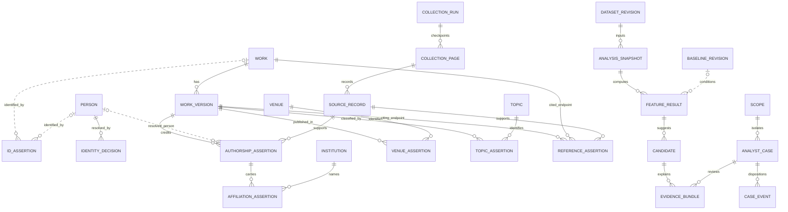

# Citation intelligence: temporal evidence architecture and storage ADR

**CITE-01 · axel-windows · issue #58 · DESIGN ONLY / INDEPENDENT REVIEW REQUIRED**

Prepared 2026-11-08. Assigned and inspected main: `47fb9d79f3e5cbdf9062579f1d65b2e253f2486a`.
Only this document is delivered. No migration, runtime, API, collection, graph store,
deployment or scientific validation is delivered or authorized. All new names,
contracts, limits and integration paths below are **proposals** pending manager
reconciliation with DB/data-engineering, identity and evaluation reviewers.

## 1. Decision context and current code trace

The target is a supervised research-integrity pilot, not autonomous adjudication.
PostgreSQL remains the owner-directed portable self-hosted platform for customers
and the overall project; Neon is the current source, not a required future service.
The investigation storage choice is **open**: compare PostgreSQL-only processing,
a rebuildable graph projection, and graph authority without a measured winner.
An optional GraphQL investigation facade is an API choice, orthogonal to storage.
No vendor or new endpoint has been selected by the owner.

Read `PRODUCT.md`, `docs/product-milestones.md` and `docs/PILOT-DELIVERY.md` as product
context, not proof of current capabilities. The following is source inspection at
the exact main pin, not a runtime test or a historical data inventory:

| Existing path / line anchors | Definition and implication |
| --- | --- |
| `backend/app/models/researcher.py:19-77` | `ResearcherProfile` is user-owned, optionally organization-scoped, with mutable scalar/JSON metrics and provider IDs. It is not a global resolved person authority. |
| `backend/app/models/researcher.py:80-158` | `PublicationAnalysis`, `ScrapedPublication`, `CitationEdge`, `CoAuthorRelation` are profile-associated. Cited edge endpoint is a scraped-publication FK; citing endpoint is external metadata. No canonical versioned work-pair assertion ledger or collection-run FK appears here. Legacy suspicion booleans are not verdict evidence. |
| `backend/app/models/researcher_snapshot.py:17-42` | `ResearcherSnapshot` freezes scalar/JSON fields and original capture time, not a complete immutable paper/reference input graph. |
| `backend/app/tasks/researcher_tasks.py:40-81` | `researcher_events` collects then analyzes; durable retries delete profile-associated collector artifacts and preserve prior revision. Do not treat these replaceable artifacts as an immutable global corpus. |
| `backend/app/services/scrapers/scrape_orchestrator.py:102-177,179-218,220-305,340-350` | Collector stores publications, samples citations for top 50 papers (limit 200 each), then coauthors/enrichment. Name search chooses maximum citation count; self-citation uses name matching and coauthors are keyed by lowercased name. These are identity risks, reported here, not fixed or adopted as confirmation policy. |
| `backend/app/services/academic_integrity/scholar_scraper.py:29-105,114-196,271-338` | Analyzer adapter name search takes first result; ORCID flow can attach requested ORCID after name lookup. Publication/citation fetches consume one response without a cursor-completion contract; citations distinguish `None` from empty. Requested identity is not returned-link proof. |
| `backend/app/services/academic_integrity/citation_graph_builder.py:14-18,51-108,119-162` | Builder default checks 20 papers, 50 citations each; deduplicates citing/cited relationships and author IDs, exposes paper pairs, incoming author edges and sample coverage. Its `succeeded` status does not establish exhaustive cursor/network coverage. |
| `backend/app/services/academic_integrity/orchestrator.py:168-240,344-469` | Analyzer resolves again, fetches up to 100 publications and requests only 15 checked papers. Save replaces publication analyses, preserves prior metrics, stores truncated graph display and empty rings/pairs. It does not persist the proposed full input manifest. |
| `backend/app/services/academic_integrity/ring_detector.py:1-6,77-127,129-164` | Explicitly no reciprocity/cycles/manipulation inference from incoming samples. Current “velocity” uses lifetime count divided by age and wall-clock year, not observed burst events; retain as a legacy limitation, never import as temporal evidence. |
| `backend/tests/test_researcher_evidence.py:24-110,125-171`; `backend/tests/test_ring_detector.py:119-150,153-196` | Source-authored regressions cover outage/empty distinction, dedup, partial abstention and star concentration without rings; legacy velocity tests demonstrate its present semantics. Tests read, **not rerun** in this docs-only lane. |
| `backend/app/models/analysis_run.py:10-50`; `backend/app/services/analysis_runs.py:76-139` | Existing durable execution run/lease/fencing and public progress events are not immutable scientific analysis snapshots, a private evidence journal, or a graph outbox. |
| `backend/app/models/source_check.py:21-51` | Organization NULL means private to owner, not globally public. Preserve this distinction; never infer public bibliography permission from null tenancy. |

Manifests inspected: `backend/requirements.txt` (SQLAlchemy/asyncpg/Alembic and
NetworkX; no graph-store selection), `frontend/package.json` (Next/Vitest/Playwright),
and `.github/workflows/ci.yml` (required backend/frontend checks). No dependency
change or application suite execution is needed for this document.

### Deferred CONTRACT compatibility, not merged schema

Read complete `docs/ANALYSIS-CONTRACT-V1.md` from draft [PR47](https://github.com/JafarShamzsi/ArtiProof/pull/47)
at **`198621dc9f58d980185e954aeba6ed2a778b3561`**, including review comments.
Sections 2–3 propose private fenced operation context/journal and two nullable JSON
columns; section 5 proposes same-run/attempt confirmed identity handoff; section 6
proposes frozen report snapshots and live authorization checks. None is current schema.
Its docs-correction review is not an application implementation grant.

This proposal must reuse/reconcile those concepts, not invent an independent
provider-success authority or put private evidence in `AnalysisRunEvent`. Final
business records and final provenance marker must share one fenced transaction;
never await a second conflicting journal transaction while holding business locks.
Account/auth/deletion lock compatibility remains that proposal's unresolved gate.
Its old-writer activation barrier and legacy artifact disposition also remain
future prerequisites. This document reserves no migration identifier or ownership.

## 2. Evidence semantics before storage

**Observed directed paper references precede all author projections.** A reference
assertion states that one source reports `citing_version -> cited_work` (optionally
an identified cited version). It does not state intent, endorsement or which
coauthor selected the reference. Provider aggregate counts never create edges.
An author association, shared institution or common coauthor is not misconduct.

CIDRE [S1] models journal-level weighted donor/recipient patterns relative to a
community/size-aware null model. Its Discussion explicitly requires expert judgment;
Data/Methods use a historical MAG snapshot and journal/JIF time windows. Its
comparison with suspended journals is **not researcher fraud accuracy** or a
benchmark for this application. Its Methods infer communities over aggregated
2000–2019 data: a proposed prospective replay must instead fit any baseline only
on information available at its cutoff to avoid future leakage. Its 2022 correction
[S2] fixes Figure 2 axis/legend presentation, not an author-level validation claim.

Design safeguards (requirements, not empirically established detectors):

- Preserve small-field conventions, review/bibliography papers, methods/software
  citations, large consortia, career stage, time effects, geographic/community
  structure, language and provider coverage as alternative explanations/cohorts.
- Separate `signal observation`, `evidence confidence`, `analyst disposition` and
  `externally adjudicated misconduct`. No conversion from anomaly to guilt.
- Same-name matching is candidate generation only. Citation-pattern evidence used
  by identity resolution must be disclosed to avoid circularly “confirming” the
  very behavioral pattern under investigation. OpenAlex itself documents merge,
  split, special-placeholder and ID replacement failure modes [S3].
- The threat-intelligence analogy is **evidence handling**: source reliability,
  time-bounded observations, hypotheses, counterevidence, cases and audit history.
  A researcher is not an attacker; a cluster is not a malicious organization.
  No autonomous blacklist, public real-person ranking or guilt labels.

## 3. Proposed heterogeneous temporal model

The ER diagram is a design synthesis grounded in provider work/authorship/reference
semantics [S3–S5], current code above, and the evidence/review limits in [S1–S2].
It is not a provider schema copy or an existing migration. `SCOPE` is explicit
`public_bibliography`, `personal(owner_user_id)` or `organization(organization_id)`.
Private scope is not represented by SQL NULL meaning public.

The optional links use Mermaid's [zero-or-one left endpoint and non-identifying
relationship syntax](https://mermaid.js.org/syntax/entityRelationshipDiagram.html#relationship-syntax).
Each `ID_ASSERTION` has exactly one typed owner matching its `entity_kind`:
the WORK/PERSON alternatives shown are XOR: neither nor both is allowed.
Other entity kinds require their corresponding typed
owner under the same rule; separate optional links alone do not enforce XOR.
An `AUTHORSHIP_ASSERTION` may have no resolved person: retain raw author evidence
and identity candidates without creating placeholder people. A `FEATURE_RESULT`
may have no baseline when not required by its method.
Missing required baseline still means unavailable, not a fabricated baseline
or relaxed assessment gate.

### Conceptual records, keys and constraints — NOT executable migration

All assertions have immutable UUID assertion ID, scope ID, source-record FK,
parser/policy version, `observed_at`, `ingested_at`, and append-only supersession
or withdrawal events. FKs must resolve in the authorized scope; public-to-private
references are forbidden. Logical keys below do not imply a released SQL schema.

| Proposed record | Important keys / constraints / content |
| --- | --- |
| `Work`, `WorkVersion`, `VersionRelation` | Stable internal work UUID; version UUID and work FK; version kind (preprint/accepted/published/correction/unknown), source-specific version key, publication interval/precision. Version relations (`is_version_of`, `corrects`, `retracts`) need source assertions. Unknown version remains explicitly unknown, not guessed as version of record. |
| `IdentifierAssertion`, `IdentifierBinding` | Entity kind + namespaced identifier + provider record + source revision identifies a claim. Binding revision chooses accepted entity, conflicted/unresolved/retired status and policy. Unique active accepted binding per `(scope, namespace, normalized_value, entity_kind)`; conflicting claims retained separately, never overwritten by uniqueness enforcement. Internal IDs never recycled. |
| `Person`, `AuthorshipAssertion` | Stable internal person UUID; raw provider author/name and ordinal on work version; nullable resolved person; identity-decision revision FK and role/group-author flag. No unique name. Distinct provider assertions may disagree on ordinal/author; dedup is not proof of identity. |
| `IdentityDecision`, `IdentityDecisionMember` | Decision UUID/version, candidate IDs, accepted membership edges, proofs/conflicts, confidence semantics, policy/reviewer/time; merge/split/undo events link previous/new decision IDs. Split is many-to-many authorship reassignment, not a single redirect. Preserve original provider attribution for replay. |
| `Institution`, `AffiliationAssertion` | Internal institution ID with namespaced IDs (e.g. ROR) and aliases; authorship/person/institution assertion, raw affiliation, nullable valid interval + precision and recorded interval. Publication affiliation does not assert continuous employment or current affiliation. |
| `VenueAssertion`, `TopicAssertion` | Venue/topic stable ID, namespace/taxonomy version, work-version FK, source and effective interval; classifier/method version/confidence separately. Do not treat inferred topic as a verified field or overwrite historical venue titles. |
| `ReferenceAssertion` | Assertion UUID; citing-version FK; cited-work FK, nullable cited-version FK (must belong to cited work); provider reference key/locator, asserted/withdrawn/ambiguous state. Unresolved raw references are retained separately with candidate matches, not dangling canonical edges. |
| `CanonicalReferenceRevision`, `ReferenceSupport` | Revisioned resolution of work-pair/version semantics; one projected edge per declared dedup key, support table links **all** contributing assertions. Conflicts/withdrawals and duplicate/mirrored upstream lineage retained; repeated references within one paper do not inflate a paper-pair count. |
| `CollectionRun`, `CollectionPage`, `CoverageRecord` | Run UUID, provider/dataset/adapter version, exact query/filter/sort/corpus, direction, cutoff, budgets, attempt, status; page ordinal, request fingerprint, cursor in/out, completion evidence, response record IDs; coverage is per inventory/reference/authorship/direction/cohort, not one boolean. |
| `SourceRecord` | Immutable source revision ID, provider record key, collection-page FK, raw artifact pointer or unavailable reason, media type, content hash algorithm/bytes meaning, retrieval/observation time, upstream lineage, license URI/version/access time and permitted retention/redistribution. Pointer and hash alone are not scientific approval; no public raw URL containing credentials. |
| `DatasetRevision`, `RevisionMember` | Frozen input manifest with assertion IDs, source revisions, identity/dedup/date-policy revisions, scope, knowledge/event cutoffs, coverage digest, corrections/tombstones applied and canonical encoding hash. Large memberships stored as bounded chunks with chunk hashes and ordered root manifest, not unbounded JSON. |
| `AnalysisSnapshot`, `FeatureResult`, `BaselineRevision` | New immutable scientific run separate from existing mutable execution row; execution-run/attempt link, code/config/environment/seed/version pins, input manifest, status, feature units/numerator/denominator/unavailable reason, baseline training cutoff/cohort/coverage/method and input IDs. Final records not updated in place; correction creates successor plus invalidation event. |
| `Candidate`, `EvidenceBundle` | Candidate UUID/type/version and hypothesis, no fraud verdict; bundle revision pins supporting and opposing paper paths, source/identity/coverage revisions, feature/baseline/run IDs, omissions, access restrictions and integrity hash. |
| `AnalystCase`, `CaseEvent`, `CaseEvidence` | Case has mandatory private scope and access policy; event UUID/sequence, actor, assignment, disposition/reason, evidence-bundle revision, counterevidence, correction/appeal references. Event edits are superseding events. Cross-scope links denied even if canonical work ID is public. |

Suggested indexes to evaluate, not proven query-performance claims: B-tree forward
`(scope, citing_work_id, reference_revision)` and reverse `(scope, cited_work_id,
reference_revision)` edge projections; support `(reference_revision, assertion_id)`;
authorship `(scope, person_id, work_version_id, identity_revision)` and work-first
reverse; source `(provider, provider_record_key, source_revision)`; page unique
`(run_id, ordinal)` plus request idempotency key; case `(scope, status, assigned_to)`
and unique `(case_id, sequence)`; invalidation dependencies by input assertion ID.
Consider range/GiST temporal indexes and ingested-time partitioning only after
workload sizing. Check interval order, nonnegative counts, finite confidence in
its declared domain, known enum/version, required provenance and bounded payloads.
Do not constrain all papers to a perfect DAG: corrections, versions and imprecise
dates need quarantine/review rather than deletion of inconvenient observations.

### Dates, deduplication and as-of replay

- `observed_at`: when this collector observed this source assertion; not when a
  reference was made. `ingested_at`: when its durable database record was accepted.
  Provider `updated_at` and dataset-release date are separately named metadata.
- Publication date has value/earliest/latest/precision (`day`, `month`, `year`,
  `interval`, `unknown`) and basis (online/print/preprint/provider-selected).
  Reference-event date is separately nullable, with basis and precision. Citing
  publication date is a **proxy** for publication of the reference, not exact
  author action time; never silently call it a citation timestamp. Latest aggregate
  count supplies neither event date nor a list of references. Count deltas can
  include indexing/corrections; they are observation-series deltas, not proven bursts.
- Valid-time intervals describe asserted world applicability; recorded-time events
  describe what the system knew. Define half-open analysis windows `[start,end)`.
  If a year-only interval straddles a window, exclude as ambiguous or report bounds
  under a pinned policy, not January 1 invention. Unknown dates abstain for temporal
  features; contradictory exact dates are quarantined with source retained.
- Normalize identifiers by namespace-specific versioned rules, retaining raw
  strings. DOI URL/prefix/case handling does not apply indiscriminately to all IDs.
  Exact verified IDs are stronger linkage than title/name similarity, but conflicting
  metadata/ID collisions still require review. Preprint/published DOI aliases need
  explicit version relations, not blanket work collapse. OpenAlex can itself group
  multiple DOI-bearing copies under one work [S4]; preserve provider grouping as an
  assertion, not unquestioned internal identity.
- Across providers count a resolved paper pair once for a specified work/version
  aggregation rule; preserve all supports and upstream-copy lineage. Two mirrored
  providers are not two independent witnesses. Same provider record reingestion is
  idempotent by revision/content; conflicting bytes under the same claimed revision
  are retained as conflict and rejected from automatic authority. Canonicalization
  sorts typed IDs/sets deterministically; raw byte hash and canonical manifest hash
  have different explicitly recorded meanings.
- Knowledge replay selects only ingested/observed assertions within pinned cutoff,
  with the identity/dedup/correction policies available then. A newly retrieved old
  reference cannot enter a historical “known then” replay. Retrospective corrected
  replay is a separately labeled successor, not silent history replacement.
- Withdrawal/tombstone is an event with reason/effective/recorded time and successor
  links, not evidence that a reference never existed. Historical scientific replay
  remains subject to **current** access/deletion policy; if lawful erasure removes
  raw evidence, retain only permitted minimal audit metadata and label replay
  incomplete. Never promise both permanent raw reproducibility and unconditional
  erasure. Retention periods/legal holds require separate privacy approval.

## 4. Collection coverage and resource contracts

Before later collection, require approved licensed source, explicit scope/cutoff,
cost ceiling, and immutable run configuration. No real collection occurred here.
OpenAlex documentation currently specifies supported page size 100, basic paging
depth 10,000, key-required cursor continuation and a terminal cursor/empty-results
condition [S5]; old examples allowing 200 must not become hardcoded assumptions.
Its current API guide documents metered requests and restricted sync filters [S6].
No request price or free-tier assumption authorizes spending or API use now.

Run contract includes `not_started/running/completed_scope/partial/failed/cancelled`,
stop reason, expected denominator nullable, unique records observed, duplicates,
unknown identities/dates, failed pages/retry counts, cursor loops, provider total
as reported, page limit and freshness (`last_successful_observation`, source release,
staleness policy). “Completed scope” requires the adapter's explicit terminal
condition for the pinned query, not “returned fewer than limit” unless documented.
Even complete query pagination does not mean complete world bibliography.
Record both incoming/outgoing discovery coverage; missing outgoing data is unknown,
not no reciprocation. Aggregate counts and observed edge denominators stay separate.

Checkpoints commit normalized page assertions, provenance and next cursor together;
restart reuses the last committed cursor and dedups page records. API cursors are
opaque, not permanent snapshots; expired cursor or changed corpus starts a linked
new run with overlap/dedup, never claims seamless historical continuation.
Bound requests/pages/bytes/nodes/edges/author fanout/traversal expansions/retries,
wall time, concurrent jobs, and daily cost **before** work; unknown pricing or an
unapproved paid endpoint stops collection. Sanitize saved request metadata, omit
keys, honor rate-limit responses with bounded backoff, and stop repeated cursors.
Numerical production ceilings are provisional manager decisions. Any cap yields
explicit partial output, never silent truncation or “no pattern” reassurance.

## 5. ADR: compare actual storage/workload alternatives

**Status: proposed, no measured winner.** Public bibliography authority in portable
PostgreSQL plus optional graph projection is a hypothesis consistent with the
owner's platform direction, not a demonstrated performance advantage. Graph-as-
authoritative below means bibliography authority only; customers/private cases
remain PostgreSQL in every option. No installation or database benchmark performed.

| Workload / concern | A: normalized PostgreSQL + indexed projections/materialized aggregates + offline graph processing | B: PostgreSQL authority + rebuildable Neo4j projection | C: graph-authoritative bibliography + PostgreSQL customer/case records |
| --- | --- | --- | --- |
| Provenance joins, conflicts, identity/tenant lineage | Foreign-keyed assertions/supports; queries join exact revision manifests. No second authority. | Graph returns stable evidence IDs; authorized canonical hydration validates provenance in PostgreSQL. Extra round trip/version contract. | Graph must model assertion nodes, provenance and revision/uniqueness constraints itself; case references cross stores and cannot rely on local FK. |
| Temporal neighbors, bounded 1–3 hop exploration | Forward/reverse indexed joins and recursive CTE with cycle/depth/frontier limits [S7]. Cost depends on degree/selectivity/plans. | Bounded directed Cypher paths with inline temporal/type filters [S10]; projection must contain pinned temporal/identity revisions. Native paths are not automatically cheap. | Same graph query expressions; must also maintain all historical assertions or immutable snapshots, not just current edges. |
| Reciprocal author network | Join separately observed paper pairs through pinned authorships, group by directed author pair and window; reverse join. | Materialize explainable author edges with paper-support links; reciprocal match only at same projection revision. | Same projection semantics still needed; author-edge authority alone loses paper evidence. |
| Co-citation and bibliographic coupling | Co-citation: common citing paper (`x->a`, `x->b`); coupling: shared cited paper (`a->x`, `b->x`). Indexed self-joins/preaggregations or bounded offline sparse processing; high-degree expansion must be measured. | Same oriented patterns; GDS Node Similarity compares outgoing neighborhoods [S11], so coupling/co-citation require deliberately distinct orientations or role-split bipartite projections. A generic “similarity” score is not a misconduct signal. | Same algorithms, but source corrections must invalidate persisted similarity/communities as well as canonical facts. |
| Community and motif jobs | Export immutable scoped edge manifest for offline algorithms (existing NetworkX dependency is not proof of capacity). Bounded motifs can use joins; global jobs outside request path. | GDS uses separate in-memory graph catalog [S9]; estimate/catalog/algorithm memory in addition to DB/page cache. Algorithm traits and projection orientation must be pinned. | Graph authority does not eliminate graph-algorithm memory or reproducibility work. Must back up results/config/inputs alongside graph. |
| Reproducibility and updates | One authoritative transaction domain; immutable manifests and versioned aggregates still required. Materialized views are not automatically current [S8]. | Adds projection lag, duplicates, catchup/rebuild and generation-switch protocol (§6). No cross-store atomic dual-write promise. | Need graph-native history/backup guarantees plus graph-to-PostgreSQL synchronization; graph outage can halt authoritative ingest/case hydration. |
| Tenancy | Separate public schema/service access and private scope/FKs/policies; RLS possible but owners/superusers/BYPASSRLS bypass and integrity checks can leak [S12]. Tests required. | First projection public-only; private cases/notes excluded. Any private graph later needs separate scoped projection and security review, not a property-filter-only assurance. | Must prove graph privilege model for public/restricted assertions and cross-store revocation; no assumed SQL RLS equivalence. |
| Self-host licensing | PostgreSQL License permits use/copy/modification/distribution with notices [S13]. No Neon dependency required. | Neo4j Community GPLv3 identified in official terms; Enterprise subject to applicable agreement [S14]. GDS Community includes algorithms but limits concurrency/model catalog and catalog operations; Enterprise unlocks specific features [S9]. Neither all-GDS-free nor all-algorithms-paid is accurate. | Same edition review, with licensing/backup availability more consequential because graph is authoritative. Legal review of pinned packages, plugins and distribution required. |
| Backup/resources/operations | SQL dump/filesystem/continuous archive approaches documented [S15]; raw artifacts/manifests need coordinated retention/restore. Query spills/WAL/index growth/CPU/RAM must be measured. | Second service/driver/upgrade/security monitoring plus duplicate disk and GDS memory; can rebuild projection from retained canonical inputs. Neo4j Community offline dump/restore vs Enterprise online backup are distinct [S16]. Measure rebuild against recovery budget rather than assume backup unnecessary. | Graph backup becomes mandatory authoritative recovery, including raw provenance pointers, plus PostgreSQL backup; coordinated recovery point and dangling-reference reconciliation are new burdens. |

Options A and B both merit benchmark implementations after separate authorization.
C is not selected for this slice because it changes bibliography authority and
adds cross-store integrity obligations, **not because a benchmark proved it slower**.
It remains a candidate only if measured workloads and an explicit authority change
justify those obligations. A graph vendor is not preselected: Neo4j is the concrete
documented comparator, not procurement approval. An alternative would need its
own current maintenance/license/security/backup evidence before substitution.

### Benchmark plan and switch criteria — NOT results

Manager and analyst must first approve workload frequencies and provisional numeric
SLOs: p95 interactive traversal latency `T_query`, peak total memory `M_budget`,
canonical-to-serving ingestion lag `L_lag`, rebuild/restore time `R_budget`, accepted
concurrency and monthly resource/operations budget. **All values remain TBD**;
do not optimize to a fabricated production load or treat runtime of an offline
Python fixture as a database benchmark.

Later authorized isolated benchmark: fixed synthetic seeds, fixed as-of dates and
manifest hashes, graduated node/edge volumes, heavy-tail hubs/reviews/consortia,
disconnected/legitimate small fields, duplicate providers, correction/merge/split/
tombstone streams, truncated inputs and known expected path sets. Compare A/B/C
on identical logical inputs/output semantics and hardware/resource envelopes,
documenting any C implementation not available rather than claiming a result.
Publish engine/edition/version/license, schema/index/query plans, cache conditions,
CPU/RAM/disk/concurrency, seed/config/query text, repeats and raw observations.

Measure cold/warm p50/p95/p99 for provenance hydration, 1–3 hop temporal neighbors,
reciprocal-author support retrieval, co-citation/coupling and bounded motif queries;
full community jobs separately (export/load/compute/write/read). Include ingestion
throughput, catchup p95/max lag, backlog, WAL/disk/spill/I/O, whole-process peak
memory (PostgreSQL + worker; PostgreSQL + graph + GDS for B), correction latency,
rebuild time, denied-query cost and request cancellation. Use repeated randomized
query order including hubs; report timeouts, truncations and failures, not only
successful averages. Correctness equality and access-denial tests precede timing.

Switch A→B only if tuned A repeatedly misses agreed `T_query`/job budgets on relevant
workloads **and** B meets correctness, `M_budget`, `L_lag`, `R_budget`, tenancy,
licensing and operating-cost gates with a meaningful approved benefit. If both
meet budgets, operational tradeoffs—not an invented speed ranking—decide. If B
lags or exceeds memory/rebuild budget, keep A or reduce workload explicitly; do
not weaken evidence or silently truncate. Reconsider C only with explicit owner
authority approval plus proven history/constraints/restore/access guarantees and
measured net benefit. Review thresholds again when graph size/query mix changes.

### Extended ADR: minimal baseline, search and temporal analytics

Owner addition: Elasticsearch/OpenSearch, TimescaleDB and ClickHouse are permitted
**candidates**, not selected dependencies. Prefer the fewest services that meet
measured analyst and operational needs. Near-term **proposal for review**: use A
as the first measurable baseline, adding no investigation database service. This
is a sequencing/minimum-service recommendation, not a claim PostgreSQL wins all
workloads. Independent read-only data-engineer recommendation is pending manager
reconciliation; this writer neither waits for it nor edits/approves that lane.

Separate workloads and authority explicitly:

| Responsibility | Baseline / possible specialization | Never substitute for |
| --- | --- | --- |
| Durable event/assertion storage | PostgreSQL source/page/assertion/correction records and frozen manifests | A search index, aggregate, graph layout or provider aggregate count is not original evidence. |
| Full-text / faceted investigation search | PostgreSQL text search and indexed field filters; optional Elasticsearch **or** OpenSearch derived index | Relevance ranking is not identity confirmation, graph evidence or a scientific fraud score. |
| Temporal feature computation | PostgreSQL bounded groups/windows and versioned bucket tables; optional TimescaleDB extension **or** ClickHouse derived analytics | A time-series store cannot invent missing reference-event dates or fix coverage bias. |
| Graph traversal / algorithms | A or optional B as compared above; bounded offline jobs | Graph storage/algorithm output is not GraphQL or automatic adjudication. |
| Connected analyst API / visualization | Authorized REST or optional GraphQL (§7); separate graph renderer | Neither API schema nor visualization requires graph storage or grants DB access. |

| Candidate | Explicit workload / useful capability | Tradeoffs, license and adoption experiment |
| --- | --- | --- |
| Minimal PostgreSQL | Exact ID lookup; title/allowed text retrieval using `tsvector`/GIN [S21]; venue/topic/year/provider/status facets using bounded indexed filters and GROUP BY; time buckets of actual dated reference assertions and separately labeled observation/count deltas. | One engine/transaction boundary, but search relevance, facet cardinality, wide scans and analytical contention need measurement. PostgreSQL License [S13]. Prototype indexed search plus revisioned aggregate tables first, then measure under customer-write load; do not assume partitioning always helps or partition every tenant [S22]. |
| PostgreSQL + Elasticsearch projection | Bounded title/metadata multi-field retrieval, ranking and facets on a licensed public corpus; private case search only after separate authorization design. Search-visible refresh is distinct from durable canonical write [S23]. | Extra index, mappings/analyzers, heap/page cache, segment merges, shards, backups and lag. Current official FAQ distinguishes AGPLv3/SSPL/ELv2 options for free **source portions** from default **distribution under ELv2** [S24]; not Apache 2 and not universally AGPL. ELv2 restricts offering substantial engine functionality as a hosted/managed service and license-key circumvention [S25]. Pin distribution/features, review legal terms; no free-feature or cost promise. Compare against baseline search quality/latency, not graph queries. |
| PostgreSQL + OpenSearch projection | Same bounded discovery/facet workload; official tutorial documents text vs keyword mapping, terms/range facets and count scopes [S26]. | OpenSearch project states Apache 2.0 [S27], but review pinned plugins/dependencies too. Separate process/heap/index/merge/backup work and no automatic PG snapshot alignment. Do not assume Elasticsearch/OpenSearch clients, snapshots or feature/security editions are interchangeable. Compare both only if the workload justifies a search service; choose at most one absent a separately justified requirement. |
| PostgreSQL-native temporal aggregates | Cohort/year/type/provider/coverage time series; rolling denominators, known-event histograms and observation freshness summaries; recompute affected buckets from pinned canonical inputs. | SQL tables/materialized views/windows retain existing engine, with explicit refresh/publication jobs [S8]. Index/grouping/partition pruning [S22] and bounded offline export may suffice. Large scans, sort spills, write amplification and refresh competition are adoption signals to measure, not assumed bottlenecks. |
| TimescaleDB extension | High-volume repeated time-window rollups or observation-series retention where hypertable/chunk and continuous-aggregate management demonstrably reduces maintenance/compute burden. | Same PostgreSQL server unless separately deployed: not workload isolation by itself. Apache 2 edition and Community TSL edition differ; continuous aggregates, automated retention and Hypercore are listed in Community, not Apache-only [S28]. Current TSL permits internal/value-added use subject to conditions and restricts database-as-service exposure [S29]; application-specific legal review required, including API exposure. Continuous aggregates track hypertable changes but **not changes to joined ordinary tables**, and real-time aggregates default disabled since 2.13 [S30]. Identity/topic corrections therefore need explicit invalidation/rebuild, not an automatic consistency assumption. |
| PostgreSQL + ClickHouse analytics projection | Large repeated column scans/cohort aggregations and offline baseline computations, with PostgreSQL retaining customers/cases/canonical evidence. OLAP/column orientation documented [S31]; no vendor timing imported. | Apache 2.0 official source license [S32]; cloud terms/features are separate. Adds batching, storage, background merges and independent access/backup/lag concerns. ReplacingMergeTree replacement/dedup is eventual; plain SELECT may include duplicate/deleted versions [S33]. Incremental materialized views run on inserted blocks; right-side dimension changes do not trigger recomputation [S34]. Immutable dataset generations plus exact reconciliation are the initial analytical design, not assumed transactional upserts or automatic retractions. |

**Search adoption gate:** agree provisional `T_search` p95, relevance/recall-at-k
target on a fictional engineer fixture set (later licensed analyst-labeled corpus),
facet-count semantics, maximum index lag `L_search`, reindex/restore budget and
whole-host resource ceiling. Compare exact IDs, ambiguous titles/names, Unicode,
phrase/token variants, date/provider/type facets and high-cardinality fields under
concurrent ingestion/corrections. Measure timeout/partial counts, p95 end-to-end
latency including canonical hydration, relevance judgments, index/disk/memory,
merge load and customer-transaction impact. Adopt one search engine only for an
agreed capability/quality or sustained latency failure of tuned baseline, with
measured acceptable lag/access/rebuild/operations. Do not infer scientific detector
accuracy from search relevance or advertise synthetic search results as validation.

**Temporal analytics adoption gate:** agree `T_series`/batch deadline, freshness
`L_series`, correction/identity-reassignment latency and retention/recovery budget.
Compare PostgreSQL-native aggregates against TimescaleDB and/or ClickHouse only
for the identified failing workload; include late observations, late historical
references, negative corrections, deleted inputs, split identities, cohort changes
and repeated ingestion. Require exact numerators/denominators and provenance
equality at a fixed input revision before speed comparison. Approximate quantiles/
distinct counts or downsampled series must be explicitly versioned/labeled and
cannot replace exact paper evidence or case denominators. No universal crossover
volume, benchmark speedup, license-price or hardware-cost claim is made here.

### Shared projection lifecycle, retention and one-server constraints

All optional stores are disposable **derived** representations unless the owner
separately changes authority. They inherit §6's proposed outbox/durable-ack/revision
and commit-order requirements; search/analytics cannot bypass them. Each document/
row carries stable canonical ID, assertion/source manifest references, scope,
dataset/generation, schema/mapping/analyzer or aggregate-method version and knowledge
cutoff. Source raw bytes and licenses stay canonical; index snippets are not a new
evidence source. No browser connection or arbitrary search DSL/SQL passthrough.

- Rebuild a new explicit generation from one manifest; validate schema/version and
  logical membership, consume corrections/tombstones through a proven barrier,
  then publish it. Pin queries to that generation. Search point-in-time sessions
  or engine snapshots, if used, freeze engine-visible contents, **not** a shared
  PostgreSQL/as-of snapshot. Relevance order/analyzer change requires a new cursor
  and reproducibility pin. Mixed graph/search/aggregate revisions fail closed for
  scientific analysis; exploratory views must disclose each served revision/lag.
- Corrections update all affected denormalized documents and invalidate every
  affected bucket/cohort/author projection. A changed dimension/identity can affect
  old periods even when no new reference arrives. For initial analytics rebuild
  affected revisioned partitions/buckets; do not simply append another positive
  count into an increment-only view. Timescale/ClickHouse automatic refresh is not
  sufficient for the documented dimension-change gaps [S30,S34]. Retain tombstone
  revisions long enough to prevent stale retries/restores resurrecting records.
- Backpressure has separate durable/apply/search-visible/aggregate-publication
  lag and oldest pending correction metrics. Bound bulk sizes, queue bytes, retry
  duration, disk reserve and concurrent reindex/refresh jobs. Prioritize revocation/
  tombstones; if a target cannot prove current deletion checks, disable that query
  path. At storage high-water mark pause discovery and report partial/stale, never
  discard canonical assertions or unacknowledged events. Production numbers TBD.
- First search/analytics projections are public bibliography only. Future private
  indexing requires per-scope policy at engine and business layers and denial tests
  for hits, highlights, suggestions, facets and counts. A tenant predicate only in
  search `post_filter` is unsafe because aggregations run before it; global facets
  also require explicit authorization scope [S26]. Post-filtering returned IDs after
  a leaked count/snippet is too late. No private text in public index or cross-tenant
  batch/cache. Keep cases/notes in PostgreSQL unless separately justified and reviewed.
- Retain immutable original evidence/manifests according to approved license/privacy
  policy; index retention can be shorter because it is rebuildable. Downsampling
  stores bucket width, time basis/precision, counts/sums/denominators, input revision,
  coverage and approximation method; never average averages without weights or
  interpolate absent citations as observations. If raw evidence expires, mark the
  loss of replay granularity; retention jobs must not erase appeal/correction
  support silently. Legal erasure propagates to summaries and backup restore policy.
- PostgreSQL backups plus permitted raw artifacts/manifests remain authoritative.
  Optional engine snapshots accelerate recovery but require version compatibility
  and deletion replay before serving. Elasticsearch/OpenSearch snapshots are not
  perfect cross-shard point-in-time snapshots and data-directory copies are not
  supported backups [S35,S36]. Record mappings/analyzers/security configuration
  separately where absent from backup. Timescale restores need compatible PG/
  extension versions and documented pre/post-restore handling; current docs warn
  against parallel `pg_restore -j` [S37]. ClickHouse backup supports full/incremental
  recovery but replication is not backup and access configuration needs explicit
  inclusion/verification [S38]. These are requirements, not performed restore drills.
- On **one server**, PG buffers/WAL/vacuum, API/worker memory, search JVM heap plus
  filesystem cache/segment merges, graph page cache/GDS graph, and ClickHouse scans/
  merges or Timescale background jobs compete for CPU/RAM/I/O. Separate processes
  do not create physical isolation or HA. Measure whole-host peaks, sustained disk
  queue/space and customer-write p95 during reindex/refresh/rebuild/backup, including
  failure/catchup, not each vendor alone. Reserve customer transaction headroom;
  serialize heavy jobs and cap per-service concurrency/memory. If co-location cannot
  meet budgets, defer specialization or propose separately authorized capacity—do
  not install the full stack or assume moving processes buys performance for free.

Near-term stages: baseline canonical/replay + native bounded search/time aggregates;
then separately authorized search, temporal or graph experiments for a measured
gap; then **one justified specialization at a time**, independently reviewed.
GraphQL remains independent of those choices. Manager reconciles data-engineering
recommendation and this ADR at exact heads before any final selection or ownership
grant. No joint-review approval, benchmark or readiness is implied by this draft.

## 6. Rebuildable projection and proposed transactional outbox

**Not implemented.** Same contract applies to SQL indexed projections, offline
exports and a possible graph DB. No application dual-write to PostgreSQL and graph.

1. Canonical assertion/correction plus outbox event commit in one authorized fenced
   PostgreSQL business transaction. Event has UUID, scope, entity ID/revision,
   operation (`upsert`, `withdraw`, `tombstone`, `identity_reassign`), schema version,
   dependency IDs and source manifest reference; no private note or credential.
   Durable canonical commit is the acknowledgement boundary, not graph visibility.
2. Delivery is at-least-once. Consumer applies stable IDs and monotonic per-entity
   revisions idempotently; conflicting same-revision payload fails/quarantines.
   Crash after graph commit before acknowledgement repeats safely; acknowledgement
   before graph commit is forbidden. A processed-event key and graph changes must
   share the graph transaction; external checkpoint cannot fake atomicity.
3. Database sequence allocation is **not commit order**. Do not advance a consumer
   watermark to `MAX(id)` and skip an earlier uncommitted transaction. Future design
   must select either reviewed commit-ordered CDC or a durable pending-event ledger
   with leases/acks and a separately proven complete snapshot/catchup barrier.
   Until resolved/tested, no “caught up through sequence” claim is permitted.
4. Rebuild new generation from one consistent immutable dataset revision, then
   apply all committed changes not represented by that revision through an agreed
   barrier. Handle dependencies/reordering, merge/split fanout and tombstones;
   compare canonical membership/edge-support digests and counts by scope/revision.
   Counts alone are not equivalence. Atomically publish generation pointer only
   after completeness verification; keep old generation for approved rollback.
5. Serving records `projection_generation`, input revision, applied completeness
   barrier, source freshness and known backlog. Require exact pinned generation
   for reproducible analysis; reject mixed generations. If missing/behind required
   revision, disclose stale/unavailable or use bounded canonical fallback, never
   silently combine latest graph edges with old evidence. Authorization and deletion
   remain current checks even for a historical generation.
6. Projection has `Work`, `WorkVersion`, `Person`, institution/venue/topic IDs plus
   typed assertion/support nodes or edges referencing canonical assertion IDs.
   Convenience `CITES` work edges and derived author weights carry manifest,
   projection-rule version and support references. No raw uploads, case notes,
   identity secrets, opaque guilt labels or public provider credentials.

There is no end-to-end exactly-once delivery/provider billing guarantee. Durable
write, idempotent observable effect and exactly-once message delivery are different.
Dead-letter events block completeness until repaired; no dropping failures to make
lag green. Outbox retention must exceed approved recovery/rebuild window; retain
canonical snapshots independently. SQL aggregates also require revision/watermark
publication, not “materialized” as a synonym for transactionally fresh [S8].

## 7. Optional GraphQL investigation facade (owner input)

Four separate layers: **visualization** draws authorized nodes/edges; **GraphQL
schema/resolvers** expose typed API relationships; **graph algorithms** compute
versioned features; **graph storage** persists/indexes relationships. None implies
any other. GraphQL may read only PostgreSQL or later select an optional graph
projection behind the same authorized service. It does not store graphs or
automatically solve joins, tenancy or synchronization [S17–S20].

Proposed read flow: authenticated analyst → allowlisted bounded GraphQL operation →
shared authorized domain services → PostgreSQL canonical evidence/private case
records; optional public graph projection supplies bounded neighbor IDs → canonical
authorization/provenance hydration → filtered response → graph visualization.
No browser direct DB connection, arbitrary SQL/Cypher passthrough, user-supplied
query-language fragments, graph write procedure, runtime algorithm invocation,
provider discovery or collection-on-read. Customer/account writes remain existing
application responsibilities; no GraphQL mutation implementation is proposed here.

Conceptual facade, not SDL or a released API:

| Operation / object | Required contract |
| --- | --- |
| `work(id, revision)` | Stable opaque typed internal ID and explicit revision; public bibliographic fields only. Aliases resolve through versioned bindings with conflict/successor status; ID knowledge grants no private access. |
| `references(workId, datasetRevision, first, after)` | Directed connection with assertion/support IDs, date basis/precision, provenance, coverage, projection generation/freshness and truncation reason. `pageInfo` refers to this bounded query, not complete bibliography. |
| `neighborhood(workId, direction, hops, datasetRevision, first, after)` | Read-only allowed path template and expansion budget; no arbitrary graph program. Include omitted-frontier status. Canonical hydration must match graph revision; reject/restart if unavailable. |
| `case(id)` / `evidenceBundle(id, revision)` | Private owner/organization and role authorization on every object/field/traversal; public work cannot expose reverse links to private cases/notes. Current deletion/revocation policy overrides historical revision requests. |

Security and consistency acceptance requirements, grounded in official GraphQL
authorization/demand-control/batching/pagination guidance [S17–S20]:

- Resolvers delegate to shared business authorization, enforcing object **and**
  field policy on root lookup, nested relations, `node(id)`-style lookup, aliases,
  counts, batch IDs and alternate paths. Authentication alone is insufficient.
  Do not accept tenant IDs as authority from the client; derive permitted scope
  from current session/resource policy. Mask unauthorized existence consistently.
- Server-only least-privilege PostgreSQL reader can access approved public views
  and explicitly scoped private service methods; no owner/superuser/BYPASSRLS role.
  Graph credential read-only on approved public projection, with no administrative
  procedures. RLS, if later adopted, supplements rather than replaces service checks
  and requires real PostgreSQL tests [S12]. No automatic generic table exposure.
- Enforce positive capped `first`, opaque tamper-validated cursor binding scope,
  filters, direction, dataset/projection generation, stable sort and expiry. Cursor
  is not authorization; base64 is not secrecy. No cross-generation pagination or
  unrestricted `totalCount`. All nested collections need bounds [S20].
- Validate document bytes/tokens, variables, IDs, date window, aliases/root breadth,
  fragments, list depth, total cost (multiplicative fanout), hops/frontier/nodes/
  edges, response bytes, concurrent operations and per-user/tenant rate budgets.
  Set wall-clock deadline plus database/graph statement timeout and cancellation;
  deny expensive operations before execution and charge actual expansions too.
  Numeric limits remain provisional; trusted documents still need variable/cost
  checks. Introspection disabling alone is not access control [S18].
- Batch canonical ID/provenance reads to avoid N+1 [S19], but DataLoader-style
  caches are request-local and bound to principal, effective scope, policy revision,
  dataset/as-of and projection generation. Bound batch size; filter each row before
  returning. No global private cache keyed only by public work ID or case UUID.
  Separate public caches exclude private overlays; client caches clear on user/
  organization change. Private responses are no-store by default, not CDN-public.
- A request pins one dataset/projection revision; response includes requested vs
  served revision, freshness/coverage and stale reason. Graph lag never licenses
  returning deleted/private data: canonical authorization/tombstone checks happen
  before response. If required invalidation cannot be checked, fail closed. Do not
  promise one cross-database snapshot or read-your-writes from an outbox alone.
- Bound/audit operation IDs, principal/scope, input revision, cost, denied reasons
  and accessed evidence IDs without logging raw notes, tokens or manuscript text.
  Errors sanitize storage details. LLM assistance consumes the same authorized
  evidence API; source text is untrusted instructions, not authority or tool code.

Evaluate this facade against equivalent bounded existing REST/service methods:
GraphQL may support analyst-selected connected fields, but adds schema/resolver
policy, cost-validation and cache correctness work. Acceptance requires measured
API query/round-trip behavior and denial controls, not the word “graph.” No new
GraphQL package/server, UI or API route is approved by this ADR.

## 8. Private cases, signals, analyst review and correction lifecycle

Global bibliography is only licensed public source assertions. Tenant uploads,
extracted unpublished references, private identity hypotheses, cases, analyst notes
and dispositions remain private; linking to a known DOI must not publish any of
them. Public projection never includes private-origin edge contributions or private
collection targets/case membership. Personal ownership and organization ownership
are distinct immutable resource scopes; later membership is not retroactive consent.

Structured `FeatureResult` proposal: `schema_version`, `run_id`, `feature_name`,
`method_version`, `window`, `as_of`, `identity_revision`, `projection_rule`,
`numerator`, `denominator`, `units`, `value` nullable, `status` (`observed`, `partial`,
`unavailable`), `reason_codes`, `coverage_record_ids`, `baseline_revision` nullable,
`support_manifest`, `counterevidence_manifest`, `limitations`. Evidence confidence
is a separate structured assessment of source/identity/date/coverage uncertainty,
not misconduct probability or arbitrary provider-count multiplication.

Author projection rule must be explicit: proposed fractional mass `1/(m*n)` over
distinct confirmed citing/cited authors per deduplicated paper pair, with self/
coauthor-overlap contributions separately labeled. Missing/ambiguous authorship
prevents claiming complete mass/denominator; retain paper evidence and abstain or
report partial bounds. Unique-paper and fractional-author counts have different
units. Never silently inflate one paper reference into `m*n` independent citations.
Observed author reciprocity across different papers is not a reciprocal paper pair.
Co-citation/coupling/community/motifs are contextual features, not guilt labels.
Burst feature requires actual dated evidence/observation series, matched baseline
and coverage-change controls; lifetime count/age alone yields unavailable burst.

`Candidate` names a testable pattern hypothesis, evidence requirements and competing
explanations; its `EvidenceBundle` includes exact directed paper paths, source
locators, identity alternatives, missing directions, collection limits, feature and
baseline versions, counterevidence and current access/invalidation status. Display
“insufficient evidence” distinctly from observed absence within a completed scope.

Case state and disposition are separate: workflow `open/assigned/under_review/
closed/reopened`; analyst disposition `insufficient_evidence/needs_collection/
explained_pattern/identity_error/source_error/requires_external_review`. An external
adjudication, if lawfully recorded, needs deciding authority, document locator,
scope/date, finality/appeal status and access restriction; an analyst/model cannot
promote a candidate to confirmed misconduct. Independent domain review should
record disagreement, conflicts of interest, rationale and reviewer workload.

Correction/appeal accepts supporting documents under the same private scope,
creates an event, rechecks source/identity decisions, links counterevidence and
issues a successor bundle/run/disposition. No overwriting the original reasoning.
Dependency invalidation propagates source withdrawals, identity splits and erasure
to features, candidates, bundles, case notices, exports, graph generations and
caches. Prevent serving invalidated artifacts pending recomputation/review; notify
authorized case owners. Public bibliography corrections cannot reveal private
notes. Erasure revokes artifact access immediately, then tracks durable purge/
projection acknowledgements; restores must replay deletion policy before serving.
Backups, retention and legally restricted audit events need separately approved
policy. A public DOI does not make a private investigation public.

## 9. Bounded implementation sequence and independent review gates

No lane below is assigned by this document. Suggested future integration paths
are new `backend/app/schemas/citation_evidence.py`,
`backend/app/services/citation_intelligence/` and manager-reserved models/migration
paths; existing scraper/task/orchestrator adapters need separate explicit claims.
An optional `backend/app/graphql/investigation/` facade and visualization paths
would require later API/frontend ownership, security review and manifest approval.
CITE-02/CITE-03 outputs are independent experiments/proposals until reconciled,
not current runtime contracts or prerequisites to silently import.

| Phase (separate approval required) | Bounded acceptance before next phase |
| --- | --- |
| 0: design only, this delivery | Read code/source anchors; review storage alternatives, temporal/identity/coverage model and GraphQL distinction. Independent exact-head review; settle open policies, numeric ceilings and authority. No data/infra operations. |
| 1: offline shared-shape agreement | Manager reconciles CONTRACT/DB/data/evaluation shapes; independently authored RED assertions before implementation. Synthetic fictional cases test direction/dedup/permutation, name/ID collision, merge/split/undo, date boundaries, unknowns, cap/cursor failure and source correction. Digest proves integrity only. |
| 2: canonical persistence slice | Only after migration heads/open PR inspection and explicit ownership: actual dedicated PostgreSQL constraints/tenancy/concurrency/crash tests; source-page/checkpoint atomicity, stale-writer denial, immutable manifest replay and correction/erasure negatives. No SQLite substitution; additive/legacy compatibility and activation barrier verified. |
| 3: bounded offline feature/case tracer | Paper evidence → pinned identity → versioned feature/baseline → inspectable bundle → analyst disposition/counterevidence/appeal/export. Positive feature controls and legitimate review/small-field/consortium controls; no real-world scientific accuracy claim from fixtures. Independent evaluation protocol required before real datasets. |
| 4: measured projection decision | Approved isolated database benchmark from §5 plus outbox/rebuild fault injection (§6), duplicate/reordered event, uncommitted lower-ID event, crash/ack, deleted source and split fanout. Exact canonical/projection support equality and stale denial; select engine only from measured evidence. |
| 5: optional read-only investigation API | Separately approved GraphQL or REST implementation: actual root/nested/object/field/cursor cross-tenant denial, private-cache isolation, revocation/deletion during query, N+1 batch counts, depth/breadth/cost/time limits and stale disclosure. Frontend build/browser acceptance only in that later authorized lane. |

### Reviewer checklist / unresolved decisions

- [ ] Exact main/head and sole-path scope verified; no application/schema changes.
- [ ] Current collector vs analyzer vs immutable proposal distinguished; identity
  and aggregate-age “velocity” risks recorded, not fixed outside ownership.
- [ ] Paper direction, support dedup, version/alias collision and original provider
  attribution survive merge/split, correction and as-of replay.
- [ ] Complete-query coverage differs from complete-world coverage; incoming-only,
  unknown dates, missing identities and capped inputs cannot prove no pattern.
- [ ] Valid/recorded/observation/publication/reference dates and proxy precision
  policies are explicit; no fabricated aggregate-count event timestamps.
- [ ] Authority choice remains open; numerical SLOs/limits and benchmark hardware/
  volumes require agreement; Neo4j/GDS package/edition/license pins need legal review.
- [ ] Native search/time-series baseline compared with optional search/analytics
  candidates; independent data-engineer recommendation reconciled by manager, not
  assumed. Retention/downsampling, dimension corrections and one-server contention
  have measurable gates; no use-all-stack or source/distribution license confusion.
- [ ] Commit-order/catchup barrier is resolved and independently fault-tested before
  any outbox completeness promise; no cross-store exactly-once or dual-write claim.
- [ ] GraphQL is an API layer only; all ID paths, fields, batching/caches and graph
  fallback preserve object authorization, revision, freshness and resource bounds.
- [ ] Public bibliography never discloses tenant uploads/notes/case membership;
  private retention/erasure/legal holds, restore invalidation and appeal policy settled.
- [ ] Features/confidence/disposition/external adjudication remain separate;
  legitimate explanations and coauthor attribution limits stay visible.
- [ ] CONTRACT identity/journal/activation and account/auth/deletion lock gates
  reconciled by manager; no moving sibling contract treated as merged authority.

## 10. Task-local primary-source ledger and evidence limits

All sources below fetched as full relevant documentation/article text on
**2026-11-08**; anchors name sections/fields actually inspected. This embedded
ledger is task-local; manager scratch search results were discovery leads only.
No grounded-citations tool/skill was available in the inspected tool catalog.
Current docs are mutable; later implementation must pin selected engine/package
versions and archive permitted source revisions. PostgreSQL `/current/` resolved
to 18 in this research; current CI targets PostgreSQL 16, so latest-doc inspection
does **not** authorize a server upgrade or certify version compatibility.

| ID | Primary source and relevant anchor | Supports / limitation |
| --- | --- | --- |
| S1 | Kojaku, Livan & Masuda, [Detecting anomalous citation groups in journal networks](https://www.nature.com/articles/s41598-021-93572-3), Scientific Reports 11, 14524 (2021), DOI 10.1038/s41598-021-93572-3; Data, Methods (null model), Discussion | Journal-level directional donor/recipient model; community/size baseline, incomplete citation data, expert judgment and retrospective block-fitting limitation. No researcher accuracy transfer. |
| S2 | Same authors, [Author Correction](https://www.nature.com/articles/s41598-022-19033-7), Scientific Reports 12, 14698 (2022); correction text | Figure 2(a) yearly vs bi-yearly axis labels and omitted panel (c) axis/legend corrected; checked alongside S1. |
| S3 | OpenAlex, [Author disambiguation](https://help.openalex.org/data/authors/disambiguation/); July 2023 upgrade, Special author IDs, Known failure modes | Names are ambiguous; replacement/merged/deleted IDs and merge/split errors. Provider resolution remains an assertion, not independently verified identity. |
| S4 | OpenAlex, [Work attributes](https://help.openalex.org/data/works/attributes/); doi, publication_date, authorships, referenced_works, counts_by_year, updated_date | Direction, multiple copies/DOIs, author truncation, aggregate date/freshness distinctions. No API/customer records fetched. |
| S5 | OpenAlex, [Paging](https://help.openalex.org/api/paging/); Basic paging, Cursor paging | Supported page maximum, cursor key requirement/termination; paging is not corpus completeness. |
| S6 | OpenAlex, [API guide](https://docs.openalex.org/api-guide-for-llms); Authentication, Query limits, Pricing, sync filters | Current metering/cost/access guards; prose docs only, no key creation/API request or spending. |
| S7 | PostgreSQL, [WITH queries](https://www.postgresql.org/docs/current/queries-with.html#QUERIES-WITH-RECURSIVE); Recursive queries, Cycle detection | Recursive capability; parent LIMIT is not a safe production recursion bound. No citation workload timing inferred. |
| S8 | PostgreSQL, [Materialized views](https://www.postgresql.org/docs/current/rules-materializedviews.html); refresh semantics | Persisted result may be stale; documentation example timings are unrelated and not used as citation benchmarks. |
| S9 | Neo4j, [GDS Introduction](https://neo4j.com/docs/graph-data-science/current/introduction/); Graph Catalog, Editions; [Defaults and Limits](https://neo4j.com/docs/graph-data-science/current/production-deployment/defaults-and-limits/) | Current 2026.10 docs: in-memory catalog, Community all algorithms/max four CPU cores/three models, Enterprise catalog/monitoring/limits/cluster capabilities. Not a universal free-feature promise. |
| S10 | Neo4j, [Variable-length paths](https://neo4j.com/docs/cypher-manual/current/patterns/variable-length-patterns/); Quantified relationships, Predicates | Bounded path syntax and path-explosion caution; no measured superiority. |
| S11 | Neo4j, [Node Similarity](https://neo4j.com/docs/graph-data-science/current/algorithms/node-similarity/); Introduction, Limit results, Memory estimation | Outgoing-neighborhood comparison/orientation; topK does not eliminate all-pairs compute. Example memory figures do not size this project. |
| S12 | PostgreSQL, [Row security](https://www.postgresql.org/docs/current/ddl-rowsecurity.html); bypass, referential integrity and policy race caveats | RLS mechanics/limits, not evidence this app has RLS or proven isolation. |
| S13 | PostgreSQL, [License](https://www.postgresql.org/about/licence/); complete license text | Permissive self-host use/distribution with notices; no operational readiness implication. |
| S14 | Neo4j, [Legal terms](https://neo4j.com/licensing/); Self-managed, Developer offerings; official [GDS license text](https://raw.githubusercontent.com/neo4j/graph-data-science/master/LICENSE.txt) | Community GPLv3 vs applicable commercial agreements; GDS notice references additional notices/licenses. Master text is not a pinned distributable bill of materials; complete package/legal review remains required. |
| S15 | PostgreSQL, [Backup and Restore](https://www.postgresql.org/docs/current/backup.html); three approaches | SQL dump/filesystem/continuous archiving choices, not a restore drill. |
| S16 | Neo4j, [Backup and restore](https://neo4j.com/docs/operations-manual/current/backup-restore/); edition command lists | Community offline dump/restore/consistency vs Enterprise online backup capabilities; no backup executed. |
| S17 | GraphQL Foundation, [Authorization](https://graphql.org/learn/authorization/); Type and field authorization | Authentication plus shared business-layer object/field authorization, not directive-only enforcement. |
| S18 | GraphQL Foundation, [Security](https://graphql.org/learn/security/); Demand control, Error messages | Trusted operations, pagination, depth/breadth/batch/cost/rate limits; introspection hiding insufficient. Numerical project limits are design decisions. |
| S19 | GraphQL Foundation, [Performance](https://graphql.org/learn/performance/); N+1 Problem, Demand control | Batching/caching can mitigate repeated fetches, not automatically secure shared tenant caches or prove performance. |
| S20 | GraphQL Foundation, [Pagination](https://graphql.org/learn/pagination/); Pagination and edges, pageInfo | Connection/cursor API pattern, distinct from storage edges and provider collection completion. |
| S21 | PostgreSQL, [Full Text Search](https://www.postgresql.org/docs/current/textsearch.html) and [Preferred indexes](https://www.postgresql.org/docs/current/textsearch-indexes.html); GIN/GiST | Native search/index capability, not proof it meets this corpus's relevance or latency needs. |
| S22 | PostgreSQL, [Table partitioning](https://www.postgresql.org/docs/current/ddl-partitioning.html); limitations, pruning, best practices | Partition/constraint/planning tradeoffs; no assumed benefit or changed production configuration. |
| S23 | Elastic, [Near real-time search](https://www.elastic.co/docs/manage-data/data-store/near-real-time-search); refresh semantics | Indexing/search visibility distinction; documented default interval is not this project's lag SLO or measured result. |
| S24 | Elastic, [Software licensing FAQ](https://www.elastic.co/pricing/faq/licensing); 2024 changes, distribution vs source | AGPLv3/SSPL/ELv2 source options vs ELv2 distribution. FAQ marketing terminology does not override license text. |
| S25 | Elastic, [Elastic License](https://www.elastic.co/licensing/elastic-license); complete text, Limitations | Hosted/managed feature exposure, license-key and notice restrictions; not project legal approval. |
| S26 | OpenSearch, [Faceted search](https://docs.opensearch.org/latest/tutorials/faceted-search/); mapping, terms/ranges, post_filter/global counts | Text/keyword and aggregation scopes; tutorial query examples are not tenant-safe templates without added authorization. |
| S27 | OpenSearch, [About](https://opensearch.org/about.html); project and principles | Apache 2.0 project license and self-host candidate; pin plugins/versions later. |
| S28 | Tiger Data, [TimescaleDB editions](https://docs.timescale.com/about/latest/timescaledb-editions/); edition descriptions and complete feature table | Apache edition vs Community TSL; continuous aggregates/retention/Hypercore distinction. No installed-edition query performed. |
| S29 | Timescale, [TSL](https://raw.githubusercontent.com/timescale/timescaledb/master/tsl/LICENSE-TIMESCALE); complete text, §§2–3 | Internal/value-added licensing conditions and service/interface restrictions, beyond shorthand “free self-hosted.” Mutable master needs release pin/legal review. |
| S30 | Tiger Data, [Continuous aggregates](https://docs.timescale.com/use-timescale/latest/continuous-aggregates/about-continuous-aggregates/); real-time defaults, JOIN restrictions, invalidation | Background refresh does not track joined ordinary-table changes; version-dependent behavior. Vendor performance/compression claims not adopted. |
| S31 | ClickHouse, [Introduction](https://clickhouse.com/docs/intro); OLAP/column orientation | Candidate workload class only; vendor example timings are not application benchmark evidence. |
| S32 | ClickHouse, [License](https://raw.githubusercontent.com/ClickHouse/ClickHouse/refs/heads/master/LICENSE); complete Apache 2.0 text | Open-source server license; source pin/cloud offering distinction remains. |
| S33 | ClickHouse, [ReplacingMergeTree](https://clickhouse.com/docs/concepts/features/operations/update/replacing-merge-tree.md); dedup key, querying, merge behavior | Eventual replacement and query-time correctness/deletion caveats; not a PostgreSQL constraint replacement. |
| S34 | ClickHouse, [Incremental materialized view](https://clickhouse.com/docs/concepts/features/materialized-views/incremental-materialized-view.md); Background, JOINs, CTEs | Insert-block trigger vs dimension-change invalidation; examples/timings not used as scientific/storage benchmark. |
| S35 | Elastic, [Snapshot and restore](https://www.elastic.co/docs/deploy-manage/tools/snapshot-and-restore); contents, snapshot times, compatibility, warnings | Cross-shard time interval, version and configuration limits, supported backup distinction. |
| S36 | OpenSearch, [Take/restore snapshots](https://docs.opensearch.org/latest/tuning-your-cluster/availability-and-recovery/snapshots/snapshot-restore/); introduction, compatibility, security considerations | Noninstantaneous shard snapshots, forward compatibility and separate security restore precautions. |
| S37 | Tiger Data, [Logical backup](https://docs.timescale.com/self-hosted/latest/backup-and-restore/logical-backup/); whole database restore | PG/Timescale version tracking, pre/post restore, no parallel `-j`; docs procedures read, not executed. |
| S38 | ClickHouse, [Backup and restore](https://clickhouse.com/docs/concepts/features/backup-restore/overview.md); introduction, backup types, access tables | Replication not backup; restore practice and access-config/version caveats. No live storage access or backup run. |

Research retrieval limits: one web-search call was cancelled and was not retried;
initial guessed article URLs failed and are not evidence; incorrect documentation
paths returned 404, and one research host returned 403. The correct manager-seeded
CIDRE article and its linked correction were subsequently fetched/read in full,
including Methods/Discussion/change history. No claim rests on a search snippet,
failed retrieval or uninspected citation in another paper's bibliography.

Verification for this delivery is static document/scope/source-anchor checking
and `git diff --check` only (exact commands/results in the draft PR). No executable
experiment was added, so no RED/GREEN experiment test is claimed. Application unit,
PostgreSQL integration, browser, build, provider, database benchmark and deployment
acceptance are **not run / not established**. Mermaid is source-reviewed only, not
rendered. Rollback removes this proposed document; no runtime/data state changed.
Publish draft exact-head handoff and **stop for independent review**, with no merge,
self-approval, issue closure or follow-on implementation.
