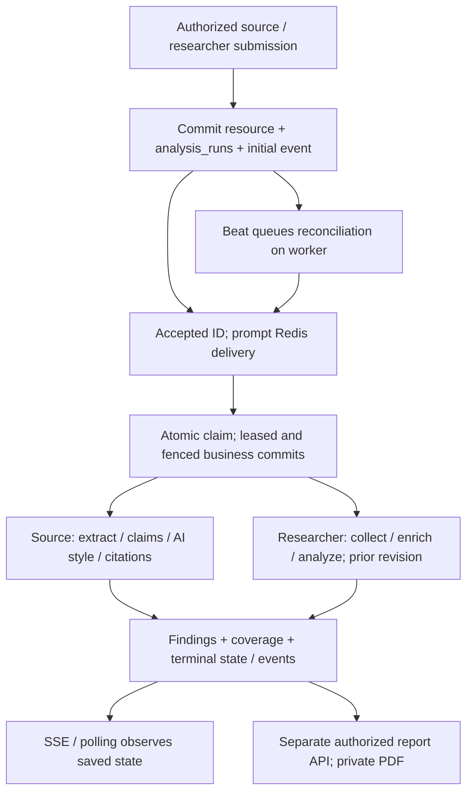
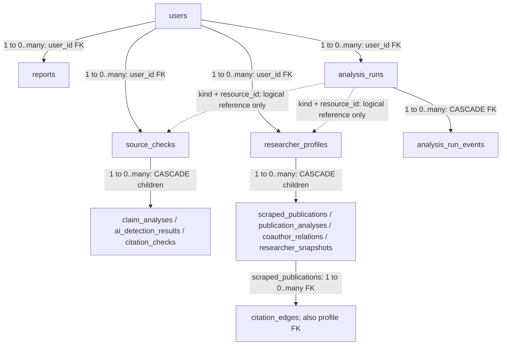

# Data-engineering handbook

## Reading contract and implementation status

Engineer review package for the supervised research-integrity pilot, **not a
deployment certificate**. Source baseline: application/main
`47fb9d79f3e5cbdf9062579f1d65b2e253f2486a`; historical README implementation parent:
[PR #57](https://github.com/JafarShamzsi/ArtiProof/pull/57), corrected head
`752ec2dba0355fa0c29dfb77979c0746c0833e2e`. The corrected README was incorporated
via squash merge on main at `58ddbd0c9f2a60a06b2f28622b4f84620dc61ab0`, whose
tree equals that implementation parent. This does not establish sibling or
production acceptance.
This documentation adds no runtime behavior. Current claims must be rechecked at
the integrated SHA; historical evidence in linked runbooks is not fresh acceptance.

**Implemented** below means observable definitions/call paths in this branch, not
proof of live configuration. **In progress** means separately owned DB-01 or
DATA-03 work under [issue #50](https://github.com/JafarShamzsi/ArtiProof/issues/50);
their contracts are proposals here until pinned, reviewed and integrated.
**Planned / live unverified** means an approval/evidence gate, not available tooling
or completed operations. See the concise [README status table](../README.md#for-data-engineers).

DB-01 proposes bounded connection policies, driver-specific verified TLS, safe
Alembic URL interpolation and telemetry disposal. Its planned path is
`docs/DATABASE-CONFIGURATION.md` (not a link: absent on this branch).
DATA-03 proposes a bounded, fail-closed, synthetic-only metadata contract/planner,
not an extractor/importer/sanitizer. Its planned path is
`docs/STAGING-DATA-CONTRACT.md` (also absent here). Do not assume proposed setting
names, CLI contracts or tests are implemented. Neither lane clears runtime holds.

**Hosting intent, not deployed:** Dokploy on the supplied server, IP-first access
and domain later. **Neon is the temporary current data source, not intended
production hosting.** Before launch the retained database is to migrate to standard
self-hosted PostgreSQL on the current Dokploy server or a separate dedicated
server; topology and workload targets await owner decisions. Processing and DB
configuration contracts must remain portable, with no Neon-specific dependency.
Development [Compose](../docker-compose.yml)
uses service-local PostgreSQL; the draft candidate in
[PR #56](https://github.com/JafarShamzsi/ArtiProof/pull/56) is separate preparation,
not merged deployment automation. Remote PostgreSQL and HTTPS/IP routing adaptation
remain pending. Staging is **not deployed**; no public website URL is verified.

## Processing and provenance: implemented source

All nodes describe **implemented code**; none certifies provider or deployment
availability. Future DB-01/DATA-03 changes are deliberately outside this diagram.
PostgreSQL is intent/results storage, Redis is delivery, and PDFs use a separate
private artifact backend. This is an application pipeline, not a medallion
warehouse, Kafka CDC, dbt or Airflow deployment. There is no implemented general
transactional outbox with atomic broker acknowledgement; recoverable run dispatch
does not make DB, Redis, providers and object storage one transaction.

### Source ingestion and findings

[Submission routes](../backend/app/routers/source_check.py#L101-L180) validate
creation membership/quota. Text/URL requests create a check; PDF uploads validate
extension, size and signature, then store original bytes before the DB transaction.
`input_content` holds text, a URL, or a document filename according to `input_type`;
it is not always extracted body text. A failed DB commit can leave an orphan PDF.
[create_check](../backend/app/services/source_verification/orchestrator.py#L81-L110)
commits the check, run, pointer and initial event before returning the accepted ID.
Bulk paths still need per-request scope/quota review; no ingestion-wide deduplication
or client idempotency-key guarantee is claimed.

The [source pipeline](../backend/app/services/source_verification/orchestrator.py)
extracts URL/PDF text (including PDF positions) or uses pasted text, extracts
claims, performs claim verification and AI-style estimation, analyzes available
citations, traces selected claim origins, optionally annotates PDFs, and saves
findings/score metadata. Failure to extract sufficient text fails the check; it
does not analyze the URL/filename as article content. Step failures can preserve
other findings and produce partial coverage; a completed job is not complete
evidence. PDF/pasted-text bibliography extraction remains unsupported in this path.
Read warning/context fields before interpreting an empty child table as no findings.

`claim_analyses.sources`, `origin_trace`, text positions, `model_metadata` and
`score_breakdown` carry useful lineage. Prompt versions/live hashes, formula
versions, provider labels, API usage and processing warnings help identify the
method; they do not store every provider response or reproduce a nondeterministic
external service. Some stages still gate on Gemini configuration and some metadata
is provider-specific: do not infer alternate-provider parity from the factory.
Model-generated URLs/verdicts are not retrieved, matched supporting passages.
Scores are heuristic; unknown is not zero or clearance. See
[score contracts](../backend/app/schemas/breakdown.py) and
[governance metadata](../backend/app/schemas/governance.py).

### Researcher collection, analysis and revisions

[Researcher routes](../backend/app/routers/researcher.py) commit a user-owned,
originally scoped profile/run before optional broker delivery. The
[collector](../backend/app/services/scrapers/scrape_orchestrator.py) resolves ORCID
or a name, collects Semantic Scholar profile/publications and sampled citation
edges/coauthors, optionally uses Google Scholar, and enriches with CrossRef.
Name search selects a candidate by citation count; this is **not identity
verification**. Provider identities, DOIs, `data_source`, `scraped_at`, author JSON
and cited/citing paper identifiers support lineage. `raw_data` exists as a column;
its presence does not prove that a complete raw response was populated or archived.

[researcher_events](../backend/app/tasks/researcher_tasks.py#L40-L81) runs collection
before the [academic analyzer](../backend/app/services/academic_integrity/orchestrator.py).
These paths overlap in external collection; do not model them as one perfectly
deduplicated provider request. During retry, collector children are rebuilt and
the original pre-attempt revision is retained in `analysis_runs.prior_revision`.
`researcher_snapshots` preserve previous scalar/rich metrics and capture time when
results are replaced, including unavailable revisions. They are not a complete
versioned archive of all publication/edge rows, provider payloads or PDF exports.
Current `publication_analyses` rows are replaced rather than accumulated as history.
Compare formula versions before charting deltas. Citation sampling/concentration is
exploratory, not a proven ring or misconduct finding; absent/partial evidence can
withhold adjusted metrics and scores.

### Durable execution, fencing and recovery limits

Read [analysis_runs.py](../backend/app/services/analysis_runs.py),
[task entry points](../backend/app/tasks/analysis_tasks.py) and the
[execution runbook](analysis-execution.md) together:

- `queue_run` locks the resource, rejects an active current run, and records
  `kind`, `resource_id`, owner and prior researcher revision in the caller's
  transaction. The partial unique index prevents two queued/running runs for a
  `(kind, resource_id)`. It does not deduplicate two newly created resources with
  identical input. If HTTP acceptance is uncertain, inspect history; do not blindly
  replay submission.
- `claim_run` atomically changes eligible queued intent to running, increments
  attempts and assigns an owner token/lease. Duplicate delivery of a running or
  terminal run is ignored. `ExecutionSession.commit` locks the resource, checks
  current-run/non-deletion, and extends only the matching unexpired owner lease.
  These are cooperative application write fences, not a DB-wide ban on arbitrary
  SQL or old writers. Stop old writers before upgrades.
- Current lease is 360 seconds; Celery soft/hard limits are 240/300 seconds.
  Lease refresh happens at fenced commits, not a separate heartbeat during an
  arbitrarily long external call. The default run attempt limit is three.
- Singleton beat submits reconciliation every ten seconds. The worker scans up
  to 100 expired attempts and locks resource then run. Committed completed/failed
  results are finalized without recomputation; unfinished work is requeued until
  exhausted, then failed; deleted/replaced resources cancel the run. Queue and
  resource status are related but separate state machines.
- Dispatch selects up to 25 due queued runs with `FOR UPDATE SKIP LOCKED`, ordered
  by creation; successful publish delays re-delivery by 30 seconds, publish failure
  by 15 seconds and breaks that batch. Publish can succeed before its transaction
  commits, so duplicate delivery remains possible. These bounds are source
  constants, **not capacity guarantees**. Without workers work stays queued;
  without beat durable retries/expired-attempt repair stop.
- SSE reads committed `analysis_run_events`, ordered by increasing event ID with
  `Last-Event-ID` replay; resource authorization precedes observation. It does not
  execute/cancel a job. Events are progress, not an immutable compliance audit.
  A disconnected UI can poll the accepted resource. Legacy active rows without
  runs require reviewed explicit rerun; GET does not silently queue them.

Application/transport retries can repeat paid provider requests after an ambiguous
response or crash. [with_retry](../backend/app/utils/retry.py) adds bounded
exponential backoff/jitter at opted-in call sites, with retryable HTTP status and
exception handling; it is not applied universally. The LLM factory also has
per-process fallback/degradation state, not a global spend reservation. Fencing
prevents stale business commits on these paths, not repeated side effects or
exactly-once billing. Partial collector commits and orphan objects remain possible.

## Logical relationships and data dictionary

**Implemented model/migration relationships, not an inventory of a live schema.**
The compact flowchart uses labels for cardinalities; a child count may be zero.
It deliberately separates actual FKs from application-only references.

Solid arrows are the stated FK relationships; dotted arrows are **implemented
application conventions**, not planned FKs or enforced polymorphic integrity.
`current_run_id` on each source/profile is an optional FK to `analysis_runs` with
`ON DELETE SET NULL`; there is no unique constraint proving a run belongs to only
one pointer. Each run's `user_id` FK cascades on user deletion. Resource deletion
does not itself cascade via `resource_id`, which is not an FK. Reconciliation and
future purge design must account for retained run/event history.

Additional implemented relationships and important gaps:

- Each owned source/profile/report has exactly one `users` owner and zero or one
  `organizations` scope FK. An organization has zero or many such resources;
  NULL means personal for current records, **not proof of historical provenance**.
- `organization_members` joins users/organizations many-to-many with composite PK
  `(organization_id, user_id)` and `admin`/`member` enum. `users.organization_id`
  is a nullable denormalized primary-org pointer, not the membership ledger.
  `organization_invites` belongs to one org; nullable inviter FK does not prove
  recipient consent. Token/state/email checks live in routes.
- Single-input reports optionally reference a source/profile via `SET NULL` FKs:
  a source/profile can have zero or many reports, a report can have zero or one of
  each scalar FK. Application branches choose input/type; the DB has no general
  exactly-one-input constraint. Comparison/audit arrays are JSON identifiers,
  **not FK join tables**; deletions do not cascade through their elements.
- Each citation edge has one profile FK and one cited `scraped_publications` FK
  (both cascade). There is no composite FK ensuring the cited row belongs to that
  same profile. Provider IDs/DOIs are not global unique ingestion keys here.
- `sessions` and `auth_tokens` belong to users; org audit/invite, billing/audit and
  telemetry tables add operational data. See [all models](../backend/app/models)
  rather than interpreting this diagram as the entire database.

Definition anchors: [source/findings](../backend/app/models/source_check.py),
[researcher/graph children](../backend/app/models/researcher.py),
[prior snapshots](../backend/app/models/researcher_snapshot.py),
[runs/events](../backend/app/models/analysis_run.py),
[reports](../backend/app/models/report.py),
[membership](../backend/app/models/organization_member.py) and
[invitations](../backend/app/models/organization_invite.py). Cardinalities describe
schema allowance, not observed row counts or historical-data conformance.

### Dictionary, classification and retention assumptions

Classifications below are **proposed handling requirements**, not deployed DB
labels, encryption policies or a compliance certification. Names are current
source names; nullable columns must preserve unknowns.

| Data family / key fields | Meaning and lineage | Classification / retention review |
| --- | --- | --- |
| `users.id`, email, role/tier, org pointer; `organization_members`, invites/audits | Account identity, access and consent state; role/tier is not a DB principal | Restricted identity; security/owner decides account and audit retention |
| `sessions`, `auth_tokens`; invite/share tokens; `users.totp_secret` | Authentication/access capabilities; TOTP secret is currently plaintext in the model | Highly restricted secrets; revoke copied capabilities, never publish/export to fixtures; key management and purge policy need review |
| `source_checks.id`, `input_type`, `input_content`, PDF refs, `text_position_map` | Submitted material and original/annotated artifact lineage | Confidential research content; filenames/URLs/positions may identify people or documents |
| `claim_analyses`, `ai_detection_results`, `citation_checks` | Child findings, paragraph text, explanations, sources and issues | Confidential derived content; no automatic public classification from a provider URL |
| `researcher_profiles`, `scraped_publications`, `citation_edges`, `coauthor_relations` | Selected identity, provider IDs, source/time, abstracts/authors, sampled graph | Personal/research data even when publicly sourced; retain license/access provenance |
| `publication_analyses`, `researcher_snapshots`, breakdown/metadata JSON | Current analysis versus prior metric revisions; method/coverage | Sensitive inferred assessments; never relabel historical scores as newly verified |
| `analysis_runs`, events, `prior_revision`, lease/attempt/error fields | Execution lineage and progress, not reviewer disposition | Restricted operational data; event detail/JSON can contain sensitive text; explicit purge policy pending |
| `reports`, annotations, input ID arrays, `pdf_path`, share expiry | Derived snapshot/export and bearer-capability access | Confidential export; share link is a capability, not a privacy boundary |
| `llm_metrics`, `celery_run_log`, `celery_dlq` | Provider usage/latency, task state and captured failures/payloads | Restricted telemetry; DLQ args/kwargs/error/traceback may contain secrets/content; minimization, access and retention need approval |
| Billing events/tier audit and sales leads | Subscription scaffolding, administrative history/contact records | Restricted financial/contact metadata; owner defines purpose/retention separately |

Current [cleanup](../backend/app/tasks/cleanup.py) hard-deletes soft-deleted
source/profile/report rows after 30 days, cascading applicable children, then
removes old unreferenced artifacts after a 24-hour grace. Live and recoverable
soft-deleted references protect files. Default beat cleanup is daily at 03:00 UTC;
storage enumeration has its own deletion cap. These defaults are **not an approved
retention schedule**, account-erasure guarantee or proof that shares/cached PDFs,
backups, telemetry and external providers are purged together.
`ARTIFACT_CLEANUP_HOLD_UNTIL` only holds orphan-file cleanup, **not DB hard deletes**.
Hold DB deletion separately during migration/rollback; monitor hold expiry. No
general automated telemetry/run-event retention is established by these paths.

## Trust boundaries and original scope

### Implemented application controls, not RLS guarantees

Browser bearer authentication, ticketed SSE, explicit public share capabilities,
worker service access and provider outbound calls are separate trust boundaries.
See [auth dependency](../backend/app/utils/auth.py),
[membership freshness](../backend/app/deps/org.py),
[organization routes](../backend/app/routers/organizations.py) and
[ownership helper](../backend/app/utils/ownership.py). Creation validates current
membership; invitation acceptance requires an explicit authenticated POST by the
matching verified-email recipient with the exact pending stored token. Opening a
link/signup is not acceptance. Historical memberships are not thereby repaired.

Direct owners can access their resources. The helper also allows an admin of the
same non-NULL resource organization; ordinary members do not gain broad read
access merely from membership. Global admin operations have separate route guards;
do not infer global versus org admin equivalence from a shared word. Application
filters/guards are not PostgreSQL row-level security (RLS) guarantees or proof that
every route/export/legacy row has correct provenance.

[Interactive reports](../backend/app/routers/reports.py) inherit **original scope**
from authorized inputs, including personal NULL, not the author's current org.
Comparison/audit inputs must have identical scope before generation. Moving teams
does not transfer earlier work. On cache miss, missing/deleted/drifted inputs deny
regeneration (410); existing same-scope cached PDFs remain snapshots, not a full
revocation mechanism. Public report shares have expiry/deletion/rotation checks;
source shares use a separate optional token. Revoking one does not revoke all
derived exports. Historical mis-scoped reports/shares require separate remediation.
Report expiry defaults to 90 days, but the current share helper accepts legacy
NULL expiry; source-share tokens have no corresponding expiry column in this
model. Do not assert all historic capabilities expire or revoke them by assumption.
Report input IDs reference mutable current resources, not immutable run/revision
IDs; cache-miss regeneration can use newer same-scope results. Neither cached PDFs
nor input references establish a versioned reviewer-approved evidence archive.

Scheduled reports are **intentionally disabled**: `report_schedules` lacks durable
original tenant scope. Creation/reactivation and execution are blocked; an old
active flag is not enabled delivery. Do not re-enable by inferring today's org.
See [scope/scheduling contract](REPORT-SCOPE-SECURITY.md),
[disabled task](../backend/app/tasks/scheduled_reports.py) and
[schedule routes](../backend/app/routers/report_schedules.py).

### Planned least privilege for engineer/security approval

This is a role proposal, **not implemented grants**. Current constructors use
shared URL settings; no verified live privilege inventory or service-role split
is claimed. Application `users.role`/membership enums are not PostgreSQL roles.

- Separate migration owner (DDL, time-limited direct connection) from API/worker
  DML principals. Neither routine runtime principal should own schemas, create
  roles, bypass RLS or have superuser rights. Worker needs claim/event/result
  writes, not unrestricted operator recovery authority.
- Give telemetry only required inserts/sequence access and narrowly scoped reads
  to the operator reporting identity. Define failure behavior if telemetry denies
  access; best-effort logging must not fail business execution.
- Restrict backup/restore and copy custodian identities separately; expose only
  sanitized aggregates to reviewers. Audit access to reports and sensitive DLQ.
- Private artifact roles should be scoped to the destination bucket/prefix;
  separate routine reads/writes from deletion/migration/recovery where reviewed
  tooling permits. Never grant account-wide storage administration to the app.
- Isolate test Redis/queues/artifact prefixes/provider credentials from production.
  Require TLS, secret provisioning/rotation, egress allow rules and explicit
  provider data-processing permission. Verify denied operations with real grants
  before claiming least privilege is enforced.

## Schema, indexes and measured scale review

### Implemented constraints and index families

The checked-in migration chain runs `0001_baseline` through
`0018_analysis_runs` (filename `0018_durable_analysis_runs.py`), parent
`0017_team_plan_v1`. Review actual revision strings, not filename shorthand.
[0001](../backend/alembic/versions/0001_baseline.py),
[0002](../backend/alembic/versions/0002_phase3_indexes_enums_constraints.py),
[0011](../backend/alembic/versions/0011_perf_composite_indexes.py) and
[0018](../backend/alembic/versions/0018_durable_analysis_runs.py) define key paths:

- UUID-like string PKs on business rows; identity bigint PK on run events; owner
  FKs, child cascade FKs, unique email/share indexes and membership composite PK.
  Check/analysis statuses use PostgreSQL enums; run kind/status and attempts use
  CHECK constraints. Score/confidence/probability range checks preserve permitted
  NULLs; range validation does not establish evidence quality.
- Source history: `ix_source_checks_user_status`,
  `ix_source_checks_user_created`; child source/profile FK indexes; status and
  soft-delete indexes. Researcher has `ix_researcher_profiles_user_status`.
  Resource `organization_id` indexes come from
  [0012](../backend/alembic/versions/0012_org_id_on_owned_resources.py).
- Report reads: `ix_claim_analyses_source_check_id_created_at`,
  `ix_publication_analyses_profile_id_year`, `ix_reports_user_id_created_at`.
  `ix_report_schedules_active_next_run_at` still exists despite disabled execution.
- Runs: `ix_analysis_runs_dispatch(status, next_dispatch_at)`,
  `ix_analysis_runs_lease(status, lease_expires_at)`, partial unique
  `uq_analysis_runs_active_resource(kind, resource_id)` for queued/running;
  replay uses `ix_analysis_run_events_replay(run_id, id)`.

These are source definitions, **not verified deployed indexes/query plans**.
Model declarations and historical index names are not a substitute for comparing
the destination catalog after authorized migration. There is no claimed unique
DOI/provider identity, JSON-array FK integrity, or automated full lineage constraint.

### Planned measurement and acceptance

On an approved representative sanitized destination, capture `EXPLAIN (ANALYZE,
BUFFERS)` with parameter distributions for owner history/status/date/score and
ILIKE text search, org activity, report child loads, run dispatch/expired leases,
event replay and admin telemetry windows. Include deep pagination, skewed tenants,
large JSON/PDF references, soft-delete growth and run/event history. `ANALYZE`
executes queries: never apply write/locking statements to production for this
exercise. Use isolated data and rollback-controlled tests where appropriate.

Acceptance owner: data engineer proposes workload and budgets; DBA reviews rows
estimated/actual, scan/sort/buffer costs, lock waits, dispatch fairness, bloat and
maintenance; manager accepts evidence. Record exact schema/SHA, dataset generation,
plans, cold/warm timings and regression thresholds. No plan/load tests were run
for this documentation. Do not add speculative indexes, partitioning, warehouse
replication or tuning claims without measured need and migration/rollback review.

## Connections, TLS and backpressure

### Implemented baseline versus DB-01 proposal

[API engine](../backend/app/database.py) currently sets `pool_size=10`,
`max_overflow=20` **per process**. Dedicated durable task/reconciliation engines use
`NullPool`, disposed per event loop; do not pool asyncpg connections across Celery
loops. [Compatibility execution](../backend/app/services/analysis_runs.py#L194-L208)
does the same. [Alembic](../backend/alembic/env.py) uses synchronous SQLAlchemy with
`NullPool`. Artifact migration uses a session advisory lock. Current sync
[Celery telemetry](../backend/app/tasks/observability.py) creates per-write engines;
disposal is after success, not guaranteed by `finally` on failure. DB-01 owns that
correction and central bounded pool/timeout/pre-ping/TLS policy; it is not present
in this source baseline. LLM metric persistence also opens best-effort async
sessions; include it in consumer/loop-isolation review, not just the main task.

**Planned connection budget:**
`API processes * (pool size + overflow) + peak worker DB connections + concurrent
reconciliation/cleanup + telemetry connections + migration/backup/admin reserve`
must remain below the approved endpoint/compute connection allowance with headroom.
For the baseline API term that is up to 30 per process, not 30 for the deployment.
`NullPool` means no retained idle pool, not a concurrency cap. Worker slots, engine
lifetimes and overlapping telemetry determine peaks; inspect every constructor.
Do not scale workers/API replicas independently of this budget or the destination
server's memory, CPU, disk IOPS and connection allowance. No measured capacity or
final workload/SLO target is established.

Bounded dispatcher batches and broker timeouts exist, but no measured global
admission controller, queue-age SLO or provider-spend reservation is certified.
Proposed backpressure: agree submission/worker concurrency limits, measure oldest
queued age and connection-acquire waits, bound provider/PDF concurrency, and test
broker/provider outages plus draining/resumption. Do not silently discard accepted
intent. Cold-start tests must include database restart/connection/TLS latency,
temporary-source wake-up where relevant during cutover rehearsal, worker
startup, provider clients, PDF font/native-library warmup, pooled saturation and
reconciliation catching up. Tune against evidence, not a promised throughput.

### Planned direct/pooled and verified-TLS policy; live unverified

Only current `DATABASE_URL` and `DATABASE_URL_SYNC` names are established here;
their presence does not distinguish endpoints or guarantee secure driver options.
Async runtime uses SQLAlchemy/asyncpg, synchronous paths use psycopg2/libpq.
Remote PostgreSQL connections must verify certificates **and hostname**, with no silent
downgrade or disabled verification. Do not copy libpq `sslmode`/`channel_binding`
parameters blindly into asyncpg. DB-01 must pin driver mapping/conflict validation
and sanitized diagnostics before new configuration instructions are authoritative.
No remote TLS handshake/negative-certificate test has run in this lane.

Proposed policy: a reviewed transaction-pooled endpoint may serve compatible
stateless API/task transactions after asyncpg/prepared-statement and reconnect
tests. A direct/session-compatible endpoint is required for the artifact
migrator's session advisory lock and proposed migration/admin path. Endpoint
spelling is not proof of topology; test connection semantics. Local loopback or
explicit isolated service-local development is not a precedent for insecure
remote access. The baseline Alembic `set_main_option` passes sync URLs into
ConfigParser unchanged; percent-encoded credentials can fail interpolation.
Preserve the [README local workaround](../README.md#1-configure-locally), never
blanket double-encode URLs; DB-01's boundary fix remains proposed here.

Manager metadata identifies **PostgreSQL 17** on the temporary Neon source, while
[CI](../.github/workflows/ci.yml) uses **PostgreSQL 16**. PG16 migrations/fixture
tests do not establish PG17 schema/import/TLS/pooler/query-plan/cold-start behavior.
Require a separately authorized isolated PG17 matrix and an explicitly chosen
self-hosted destination version before rollout; test the selected version too if
different. No live migration, provisioning or tuning is authorized by this handbook.

## Retained data, quarantine and controlled change

### Known compatibility findings, not a live schema export

Manager-provided restricted metadata was read offline for compatibility only.
Existing customer DB is retained. It has **no verified migration baseline**;
absence of observed migration history is not permission to stamp a guessed
revision. A legacy `sessions` relation collides with
[0005's create_table](../backend/alembic/versions/0005_security_sessions_2fa.py#L69-L98).
Naive timestamp versus timezone-aware expectations and JSONB versus current JSON
declarations also need explicit mapping. Do not invent UTC, ownership, consent,
status, method version or lineage where it is unknown. Full PK/FK/default/enum/
check/index metadata and safe quality validation remain prerequisites. No private
identifiers, counts, exported schema or inventory paths belong in public evidence.

Released migration behavior is itself a provenance concern:
[0012](../backend/alembic/versions/0012_org_id_on_owned_resources.py#L62-L74)
backfills resource organization from the owner's then-current non-NULL pointer;
[0013](../backend/alembic/versions/0013_organization_members.py) seeds memberships
and chooses an initial admin from existing users. These are not proof of original
resource scope, invitation consent or legitimate historical admin selection.
Inspect their actual predicates rather than relying on broad migration comments;
do not blindly run them on retained data or rewrite their released history.
Resolve uncertain records through approved mapping/quarantine instead.

### Proposed staged workflow, not executed operations

1. **Preserve:** custodian identifies an approved recoverable source snapshot and
   paired PDF store. Database references do not prove the files exist; artifact
   location/recoverability remains unverified. Do not download historic URLs to
   silently reconstruct confidential originals. Keep source production unchanged.
2. **Review metadata/mapping:** DATA-03's in-progress contract/planner is intended
   to reject incomplete/ambiguous metadata and issue blocked plans with fixed,
   sanitized reasons. It is not a live extractor, importer or authorization token;
   a digest binds a plan, not human approval. The existing
   [legacy planner](LEGACY-DATA-PLAN.md) is also not remediation evidence.
3. **Approve destination and sanitization:** prefer a separate reviewed current-
   schema destination plus explicitly mapped historical import, not a blind
   upgrade of the retained source. An in-place adaptation of an isolated clone
   requires compatibility proof first. Creating/copying a branch is itself a
   separately approved data operation; an empty DB is not retained-data acceptance.
4. **Sanitize only the approved copy:** preserve relational links and original
   tenant meaning; quarantine unknown ownership, conflicting memberships, orphan
   children, ambiguous sessions and mis-scoped reports/caches/shares. Unknown is
   neither a personal NULL tenant nor current-org ownership. Require explicit
   disposition/re-consent; never auto-join or re-stamp by today's membership.
5. **Remove copied capabilities before app access:** invalidate sessions, reset/
   verification/invitation/source-share/report-share tokens, passwords/2FA/OAuth
   credentials as appropriate, billing/provider secrets and external integration
   access. Mask identities/contact data deterministically where approved. Review
   free text, JSON, prompts/findings, annotations, URLs, raw payloads and PDFs;
   email masking or `sanitized=true` is not sufficient. Keep lineage/mapping
   evidence restricted and separate from published synthetic fixtures.
6. **Contain and reconcile:** disable outgoing mail/webhooks/providers, cleanup
   and report scheduling in the copy under an explicit reviewed process. Scheduling
   already disabled in code does not contain all outbound effects. Use dedicated
   queues/storage namespace and deny destination access to source credentials.
   Future importer must batch/checkpoint with reviewed conflict/idempotency policy,
   FK/enum/range/orphan checks, old/new reconciliation and bounded quarantine.
   No such importer is implemented by this handbook or DATA-03's planner.
7. **Verify and release separately:** reconcile approved aggregates, nullable
   unknowns, provider/method/time provenance, all input/report scope and artifact
   pairing. Test cross-user/org denial and revoked copied capabilities with real
   sessions, then authorized allowed cases. Custodian signs completeness and
   redaction; security signs access; manager/owner authorize next live stage.

### Migration/backfill/import rollback review

Before an authorized migration: enumerate all heads/open migration PRs, reconcile
the source catalog/history, stop submissions and old writers/beat/cleanup, drain
or explicitly disposition active intent, and record paired DB/artifact recovery
points. Apply reviewed Alembic once before compatible writers restart. Historical
baseline comments are not a blanket stamp recipe. Never rewrite released
migrations, run generic downgrade on customer data, or assume old-image rollback
is schema compatible.

Backfills/imports need approved mapping versions, bounded batches, checkpoints,
restart/conflict behavior, lock/timeout budgets, reconciliation and an abort plan.
Do not fabricate historical runs/consent/method versions to satisfy NOT NULLs.
Keep quarantined records inaccessible until approved resolution. Prefer reverting
an isolated failed destination to its accepted snapshot rather than destructive
source repairs; preserve a change journal and originals for the rollback window.
No SQL/import/migration commands were executed for this slice.

The existing [artifact migrator](../backend/app/cli/migrate_artifacts.py) is a
different tool: plan/apply/resume reads bytes, hashes PDFs, journals verified
copies and updates alias groups under a dedicated session advisory lock. Its
default dry-run **reads PDF contents and writes a private manifest**, so it is not
a metadata-only inventory. Do not run it under this source-only authorization.
DB and object store have no shared transaction; a failed copy can leave orphans.
See [artifact migration contract](artifact-storage.md#existing-files-and-migration).

### Planned temporary-source to self-hosted production cutover

These are **review/decision gates, not an executable migration runbook**. No live
migration, provisioning, tuning, source writes or paid service change is authorized
to this worker. There is no implemented cross-host replication/CDC, automatic
dual-write reconciliation or failback mechanism in the traced application.

1. **Choose destination and isolation:** owner/operator decide co-located Dokploy
   DB versus a dedicated server, PostgreSQL version, disk persistence/encryption,
   private network/firewall, verified TLS/direct-or-pooled routing and access roles.
   Co-location shares CPU/RAM/IO and a failure domain with PDF workers, Redis and
   web services; a dedicated DB separates those resources but adds network and
   host operations. Require process/resource isolation, disk-full behavior,
   maintenance windows and protected migration/backup access. Development Compose
   is not evidence of production DB isolation or durable backup design.
2. **Size from an approved workload:** operator/data engineer collect authorized
   aggregate size/growth and define concurrent submission, history/search, PDF,
   provider and recovery workloads without exposing contents. Test the connection
   budget, memory/CPU/IO contention, storage growth, queue catch-up, WAL/backup
   overhead and restoration under load. Targets remain unspecified; select no
   final capacity/SLO numbers or tuning based solely on this document.
3. **Rehearse preservation and mapping:** custodian/DBA validate source snapshot,
   paired artifacts, compatibility mappings/quarantine and the isolated current-
   schema destination. Review portable PostgreSQL backup/export/import methods,
   extensions/collations/roles, timezone/JSON/enum handling and tool-version
   compatibility. Restore/reconcile the rehearsal copy before approving final
   cutover; successful offline planning is not a migration or sanitized-copy pass.
4. **Approve a bounded final-write window:** manager/owner decide downtime/freeze
   and abort criteria, then stop submissions, old writers, worker/beat/cleanup and
   outbound side effects under a separately authorized operation. Capture final
   paired recovery points and dispositions for in-flight runs. A future incremental
   transfer requires an independently reviewed method; do not assume a final delta
   can be inferred from timestamps or silently enable dual writes.
5. **Reconcile before switching:** compare approved source-to-target mappings,
   constraints/orphans/status/time provenance, ownership and quarantined records,
   report/share capability disposition and artifact hashes/availability. DBA and
   custodian sign data/recovery evidence; security signs denial/allowed cases;
   operator verifies backup/restore and direct/pooled TLS. Only then may a separately
   authorized configuration cutover point compatible services at the destination.
6. **Observe or abort, then retire deliberately:** verify sign-in, accepted intent,
   worker/reconciliation, scoped findings/reports, PDF retrieval and monitoring at
   the exact release/config revision. Owner/manager decide go/no-go against agreed
   thresholds and keep the temporary source/recovery material protected for an
   approved rollback window. Before new destination writes, rollback may restore
   the paired accepted point and prior compatible routing. **After new writes,
   switching back alone loses/diverges data**: freeze again and approve a reconciled
   restore/forward-repair or separately reviewed reverse transfer. No automatic
   failback is provided. Source retirement requires explicit acceptance, retention
   and deletion authorization; it is not part of this lane.

## Recovery, telemetry and operations

### Implemented private artifacts; runtime persistence unverified

[Storage interface](../backend/app/services/artifact_storage.py) uses opaque
`artifact://v1/` references for original, annotated and report PDFs. Local writes
use a temporary file, fsync and atomic rename; local readers across API/workers
must see the **same durable filesystem**, not independent container disks. The S3-
compatible backend uses private object requests and configured bucket/prefix with
bounded SDK timeouts/retries; provisioning, public-access blocking, encryption,
versioning and backup policy remain operator responsibilities. Both paths cap PDF
bytes and validate signatures, not arbitrary document safety. Legacy file reads
are restricted to trusted roots. Storage possession itself does not authorize a
download: ownership/share checks occur in API routes. Live cross-host/restart/S3
and paired-restore acceptance remain unverified here; test SDK stubs do not prove
those properties. DB-deletion and artifact-cleanup holds are separate, as above.

### Paired recovery proposal; live restore unverified

DB recovery alone is insufficient: the accepted recovery point must bind schema/
data revision, original/annotated/report artifact references and verified object
versions/hashes, configuration/method versions and restricted migration journal.
Define backup ownership, encryption/access, retention, copy location and restore
authority with the custodian; source-provider recovery features do not establish
self-hosted backup/WAL archiving/PITR or object versioning. Verify the destination
backup chain and restore procedure independently. Missing/withheld PDFs must remain
explicit, not regenerated as alleged originals.

**RPO and RTO targets await owner/operator agreement.** No values or restore time
are certified. An approved isolated drill must restore DB plus matching artifacts,
verify referential/content hashes, scope/capability denial and allowed downloads,
reconcile queued/expired intent without unsafe replay, and measure data loss and
elapsed recovery time. Keep providers/mail/cleanup held during recovery. Restore
old DB references and source files consistently for artifact rollback; retain
backups outside cleanup roots/holds. See [release/recovery runbook](PILOT-RELEASE-RUNBOOK.md).

### Available telemetry and limitations

Implemented [LLM metrics](../backend/app/services/llm/factory.py) attempt best-effort
usage/latency/error writes with user/source/profile context; tokens/cost are not a
durable billing ledger. Background metric tasks may be lost on short-lived loops,
and fallback can hide a failed primary attempt in the final successful record.
The model has no run/attempt FK. Do not infer complete per-attempt cost attribution.
[Admin routes](../backend/app/routers/admin.py) aggregate provider/model/operation
and expose task runs/DLQ behind admin authorization. Provider degradation counters
are process-local, not global health probes. Opt-in tracing/error collection lives
in [observability](../backend/app/observability); configuration does not prove
exporter delivery or redaction acceptance.

Celery [signals](../backend/app/tasks/observability.py) record postrun status and
duration best-effort. Despite introductory comments, prerun only tracks local
start time; it does **not** insert a durable started row, and postrun inserts a
finished record rather than updating one. Failure signals write DLQ payload,
exception and traceback; there is no verified exhausted-only filter there.
The admin retry endpoint republishes the stored task and marks DLQ resolved even
if enqueue fails. Therefore resolved is not recovered, Celery SUCCESS is not an
available assessment, and an analysis run returning `status=failed` need not raise
a Celery failure or create a DLQ entry. Inspect durable run/resource status first;
manual DLQ replay is not a safe universal reanalysis command.

### Suggested metrics and alerts, not installed monitoring

- Derive oldest queued age/due backlog, running expired leases, attempt exhaustion,
  cancellations and dispatch deferrals from run fields/reconciler results. Alert
  on sustained age/lease drift and missing reconciliation; a beat process alone
  does not prove its task executes. New collectors/dashboards are planned work.
- Track accepted-to-terminal latency separately from provider/assessment coverage;
  count failed and partial/unavailable outputs, SSE/poll recovery errors and
  stale-commit rejections. Use bounded labels, no raw user IDs/tokens/text in metrics.
- Use existing LLM/token/error/task-duration/DLQ surfaces for investigation, but
  reconcile spend with provider billing under separate authorization. Alert on
  repeated retries/fallback, missing telemetry and unresolved DLQ age rather than
  trusting absence of records as healthy operation.
- Add measured DB connection/acquire latency, saturation/locks, query timings,
  artifact read/write failures, missing references and backup/restore/hold-expiry
  checks through reviewed instrumentation. Protect logs/traces/DLQ and test
  scrubbing with synthetic secrets before enabling remote export.

The operator proposes alert thresholds/escalation and manager/owner approve them
after workload evidence. No SLO/capacity promises or on-call coverage are implied.

## Verification matrix and acceptance ownership

**Existing automation:** [CI](../.github/workflows/ci.yml) runs backend Ruff error
checks, migrations, default units, and explicit real-service execution/artifact/
team-consent/report-scope integration files with a zero-skip guard. Services are
PostgreSQL 16 and Redis 7; paid-model hosts are blocked and provider keys empty.
[pytest defaults](../backend/pytest.ini) exclude `integration`. Unit stubs/SQLite
and synthetic planner tests do not prove PostgreSQL locking or isolation.
Frontend types/lint/Vitest/webpack build/ordinary smoke are separate from
authenticated journeys. Dependency audits are advisory; Bandit/conditional CodeQL
and GitGuardian disposition require independent check review. See [CI runbook](CI-RUNBOOK.md).

The [execution integration suite](../backend/tests/test_analysis_runs_integration.py)
uses controlled pipelines and kill checkpoints; the
[scope integration suite](../backend/tests/test_report_scope_integration.py) uses
real DB/session/bearer paths but stubs rendering/narratives. Neither proves live
provider quality, S3 durability, PG17 or deployment. Historical pass counts are not
repeated here; acceptance binds exact head/base and actual selected tests/skips.

| Planned acceptance / SLO-capacity matrix | Required evidence; proposed acceptance owner |
| --- | --- |
| Source/static slice (this lane) | Existing links/anchors, unchanged prior README diagrams, source contracts, migration-chain structure, owned diff and whitespace; DOCS-03 then independent exact-head reviewer |
| DB-01 / DATA-03 foundations | Exact integrated SHA, unit RED/GREEN evidence, sanitized rejection/error/driver tests and explicit limitations; lane reviewers + manager; proposals until integrated |
| PostgreSQL 17, direct and pooled TLS | Fresh/retained-schema migration compatibility, verified cert/hostname plus negative cases, pool bounds/disposal/percent credentials/advisory lock; DBA/security; not satisfied by PG16 CI |
| Durable failure/restart | Broker outage/redelivery, killed worker before/after commits, lease expiry, exhaustion, old-owner denial, original revision and host restart; backend/operator; no repeated committed results or unsafe provider replay |
| Tenant/capability boundary | Personal/org A to B transitions, real sessions, invite replay/revocation/expiry, original/derived/cache/share deny and allow matrix; security/custodian; historical quarantine separately signed |
| Ingestion/provider quality | Licensed or owner-approved text/URL/PDF corpus, provider outages/rate limits/truncation, identity ambiguity, unknown/partial scoring, cost/repeat exposure; research reviewer + owner budget authorization |
| Load/SLO and cold start | Steady/burst submissions, worker/API concurrency, tenant skew, growing history, PDF-heavy and outage recovery; p50/p95/p99 API/queue/terminal latency, error/partial rate, DB/provider/storage pressure and spend; data engineer/operator propose targets, owner accepts |
| Private artifacts/recovery | Real backend multi-instance/restart reads, missing/hash/conflict cases, migration resume and paired restore measured against agreed RPO/RTO; storage custodian/DBA/operator |
| Deployment journey | Separately approved exact-SHA candidate/checks/security disposition, self-hosted PostgreSQL cutover and IP-first HTTPS configuration, sign-in/submit/progress/result/report/recovery and verified public URL; manager + owner, not docs approval |

All runtime/provider/load/copy/restore rows remain **live unverified in this
delivery**. Evidence should record exact SHA/schema/config version, sanitized
dataset/corpus provenance, workload and limits, commands, exits, skips/failures,
timestamps, accountable owner and rollback decision. No production data, secret
values, server addresses or raw artifact references in the repository.

This slice performs source/offline documentation checks only. Mermaid checks are
structural unless an installed parser is available; no rendering acceptance is
claimed. Fresh hosted CI may run after publication, but must be read at the exact
head and cannot replace independent review or authorize runtime work. The manager
owns integration, all live holds and acceptance. Stop at independent review.
